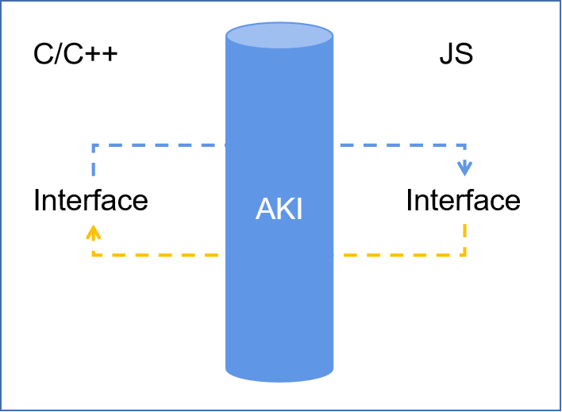

# 🚨 **重要提示 | IMPORTANT**
>
> **⚠️ 此代码仓已归档。新地址请访问 [aki](https://gitcode.com/openharmony-sig/aki)。| ⚠️ This repository has been archived. For the new address, please visit [aki](https://gitcode.com/openharmony-sig/aki).**
>
---
>
- [Introduction to AKI](#introduction-to-aki)
- [Quick Start](doc/quick-start.md)
- [User Guide](#user-guide)
- [Example Demos](example/ohos/README.md)
- [Benchmark](#benchmark)

# Introduction to AKI

Alpha Kernel Interacting (AKI) is a user-friendly development framework that allows interactions between JavaScript (JS) and C/C++ in OpenHarmony native development. It provides seamless calls between C/C++ and JS, using simplified syntactic sugar. 

## Advantages

1. Provides user-friendly APIs by decoupling foreign function interfaces (FFI) code and service code.
2. Provides features such as data type conversion, easy binding of functions and objects across languages, and thread safety.
3. Supports interactions between JS and C/C++.
4. Supports nesting with Node-API.

   


<table>
<tr>
	<th>Native C/C++ Service Code</th>
	<th>ArkTS Code</th>
</tr><tr>
<td valign="top">
<pre>#include &lt;string&gt;
#include &lt;aki/jsbind.h&gt;
&nbsp; 
// Class/struct.
struct Person {
    std::string SayHello();
    int age;
    std::string name;
    double weight;
};
&nbsp; 
// Global function.
Person MakePerson() {
    Person person = {99, "aki", 128.8};
    return person;
}
&nbsp; 
// AKI JSBind syntactic sugar.
JSBIND_GLOBAL() {
    JSBIND_FUNCTION(MakePerson);
}
JSBIND_CLASS(Person) {
    JSBIND_CONSTRUCTOR&lt;int&gt;();
    JSBIND_METHOD(SayHello);
    JSBIND_PROPERTY(age);
    JSBIND_PROPERTY(name);
    JSBIND_PROPERTY(weight);
}
JSBIND_ADDON(&lt;Name&gt;)
</pre></td>
<td valign="top">
<pre>
import libaki from "lib&lt;Name&gt;.so"
&nbsp; 
// Call the C/C++ constructor Person().
let man = new libaki.Person(10);
&nbsp; 
// Access the class/struct member properties.
console.log(man.age);
&nbsp; 
// Class/struct member function.
man.SayHello();
&nbsp;
// Call the C/C++ global function.
let woman = libaki.MakePerson();
&nbsp;
// Simplified conversion of all types.
console.log(woman.name);
</pre></td>
</tr>
</table>

## Compatible Environments
* OpenHarmony (API 10) SDK (4.0.9.6)
* DevEco Studio (4.0.0.400)
* OpenHarmony (API 9) SDK (3.2.12.2)
* DevEco Studio (3.1.0.500)

-------------------------------------------

# User Guide
* [Quick Start](#quick-start)
* [JSBind Syntactic Sugar](#jsbind-syntactic-sugar)
  * [Registering an Addon](#registering-an-addon)
  * [Binding a Global Function](#binding-a-global-function)
  * [Class Constructor](#class-constructor)
  * [Binding a Class Member Function](#binding-a-class-member-function)
  * [Binding a Class Member Property](#binding-a-class-member-property)
  * [Binding an Enum](#binding-an-enum)
  * [Thread-safe Functions](#thread-safe-functions)
* [Type Conversions](#type-conversions)
  * [Boolean](#boolean)
  * [Number](#number)
  * [String](#string)
  * [Array](#array)
  * [ArrayBuffer](#arraybuffer)
  * [JsonObject](#jsonobject)
  * [Function](#function)
  * [Reference or Pointer](#reference-or-pointer)
* [API Reference](#api-reference)
  * [napi_env](#napi_env)
  * [TaskRunner](#taskrunner)
  * [aki::Value](#aki-value)
  * aki::Promise - To be added
  * [aki::ArrayBuffer](#aki-arraybuffer)
  * [Using Node-API with AKI](#using-node-api-with-aki)

## Quick Start

- [1 Configuring Dependencies](#1-configuring-dependencies)
- [2 Customizing Service Code](#2-customizing-service-code)
- [3 Using AKI](#3-using-aki)
- [4 Calling the Code](#4-calling-the-code)

### **1 Configuring Dependencies**  
* **Source Code Dependencies** (Recommended)

  Specify the project root path, for example, **/entry/src/main/cpp**.
    ```
    cd entry/src/main/cpp
    git clone https://gitee.com/openharmony-sig/aki.git
    ```
  Add the dependencies to **CMakeLists.txt** (for example, the dynamic library name is **libhello.so**).

    ```cmake
    add_subdirectory(aki)
    target_link_libraries(hello PUBLIC aki_jsbind)
    ```
  
* **OpenHarmony HAR Dependencies**

  Install the OpenHarmony HAR dependency in the specified directory, for example, **/entry** of the project.
    ```
    cd entry
    ohpm install @ohos/aki
    ```
  Add the dependencies to **CMakeLists.txt** (for example, the dynamic library name is **libhello.so**).

    ```cmake
    set(AKI_ROOT_PATH ${CMAKE_CURRENT_SOURCE_DIR}/../../../oh_modules/@ohos/aki) # Set the AKI root path.
    set(CMAKE_MODULE_PATH ${AKI_ROOT_PATH})
    find_package(Aki REQUIRED)
  
    ...
  
    target_link_libraries(hello PUBLIC Aki::libjsbind) # Link the binary dependencies and header files.
    ```


### **2 Customizing Service Code**

Write the C++ service code in **hello.cpp**.<br>
You do not need to bother with using Node-API.

```C++
#include <string>

std::string SayHello(std::string msg)
{
  return msg + " too.";
}

```

### **3 Using AKI**

Use **JSBind** to declare the classes and functions to be bound.

```C++
#include <aki/jsbind.h>

// Step 1 Register an AKI addon.
JSBIND_ADDON(hello) // Name of the registered AKI addon, that is, the name of the compiled .so file. The naming rule is the same as that of Node-API.

// Step 2 Register the FFI feature.
JSBIND_GLOBAL()
{
  JSBIND_FUNCTION(SayHello);
}
```

### **4 Calling the Code**

Call the OpenHarmony project code:

```javascript
import aki from'libhello.so' // The .so file built by the project.

aki.SayHello("hello world");
```

## JSBind Syntactic Sugar

<table>
 <tr>
  <td>Syntactic Sugar</td>
  <th colspan="2"> AKI </th>
  <td>Description</td>
 </tr>
 <tr>
  <td rowspan="2">Addon registration</td>
  <td>From JS to C++</td>
  <td> JSBIND_ADDON </td>
  <td>Registers an OpenHarmony native addon.<br>
    <a href="#registering-an-addon">User Guide</a> </td>
 </tr>
 <tr>
  <td>From C++ to JS</td>
  <td> aki::Value::FromGlobal </td>
  <td>Obtains the properties of **globalThis** in JS code.<br>
    <a href="https://gitee.com/openharmony-sig/aki/blob/master/doc/any.md#akivaluefromglobal">User Guide</a></td>
 </tr>
 <tr>
  <td rowspan="2">Global function</td>
  <td>From JS to C++</td>
  <td> JSBIND_FUNCTION <br> JSBIND_PFUNCTION</td>
  <td>Binds a C++ global function to make it can be called from a JS addon.<br>
    <a href="#binding-a-global-function">User Guide</a> </td>
 </tr>
 <tr>
  <td>From C++ to JS</td>
  <td> aki::Value::operator() </td>
  <td> Calls a JS global function from a C/C++ addon.<br>
    <a href="https://gitee.com/openharmony-sig/aki/blob/master/doc/any.md#akivalueoperator-1">User Guide</a></td>
 </tr>
 <tr>
  <td rowspan="2">Class constructor</td>
  <td>From JS to C++</td>
  <td> JSBIND_CONSTRUCTOR<> </td>
  <td>Binds a C++ class constructor to make it can be called from a JS addon. The constructor can be overloaded. You need to specify the parameter type of the constructor.<br>
    <a href="#binding-a-class-or-struct">User Guide</a> </td>
 </tr>
 <tr>
  <td>From C++ to JS</td>
  <td> - </td>
  <td>Not supported. </td>
 </tr>
 <tr>
  <td rowspan="2">Class member function</td>
  <td>From JS to C++</td>
  <td> JSBIND_METHOD <br> JSBIND_PMETHOD </td>
  <td>Binds a C++ class member function to make it can be called from a JS addon.<br>
    Available member functions: class static function, class member function, and const class member function.<br>
    <a href="#binding-a-class-member-function">User Guide</a> </td>
 </tr>
 <tr>
  <td>From C++ to JS</td>
  <td> aki::Value::CallMethod </td>
  <td> Calls a member function of a JS object.<br>
    <a href="https://gitee.com/openharmony-sig/aki/blob/master/doc/any.md#akivaluecallmethod">User Guide</a></td>
 </tr>
 <tr>
  <td rowspan="2">Class member property</td>
  <td>From JS to C++</td>
  <td> JSBIND_PROPERTY <br> JSBIND_FIELD </td>
  <td> Binds a C++ class member property using JSBIND_PROPERTY.<br>Binds a C++ class member property accessor (Get/Set) using JSBIND_FIELD.<br>
    <a href="#binding-a-class-member-property">User Guide</a> </td>
 </tr>
 <tr>
  <td>From C++ to JS</td>
  <td> aki::Value::operator[] </td>
  <td> Accesses the properties of a JS object.<br> <a href="https://gitee.com/openharmony-sig/aki/blob/master/doc/any.md#akivalueoperator">User Guide</a></td>
 </tr>
 <tr>
  <td rowspan="2">Enum</td>
  <td>From JS to C++</td>
  <td> JSBIND_ENUM <br> JSBIND_ENUM_VALUE </td>
  <td>Binds an enum. The default enum in C/C++ is int32_t in the POD, and the property of the enum in JS is readonly.<br>
    <a href="#binding-an-enum">User Guide</a> </td>
 </tr>
 <tr>
  <td>From C++ to JS</td>
  <td> - </td>
  <td> -</td>
 </tr>
</table>

### Registering an Addon

#### JSBIND_ADDON(addonName)

Registers an OpenHarmony native addon so that it can be imported and used in JS.

**Parameters**

|  **Name** | **Type**| **Mandatory**| **Description**|
| ----------- | -------- | ------- | ------------------------ | 
| addonName   | -        | Y       | Name of the OpenHarmony native addon to register. The addon can be imported by using JS **import lib${addonName}.so**. The addon name must comply with the function naming rule.|

**Example**
- C++

``` C++
#include <string>
#include <aki/jsbind.h>

JSBIND_ADDON(addon0)

```

- JavaScript

``` JavaScript
import addon from'libaddon0.so' // Addon name: addon0
```

#### JSBIND_ADDON_X(addonName constructorAlias)
Registers an OpenHarmony native addon, whose name contains a special character, for example, a hyphen (-).

**Parameters**

|  **Name** | **Type**| **Mandatory**| **Description**|
| ----------- | -------- | ------- | ------------------------ | 
| addonName   | -        | Y       | Name of the OpenHarmony native addon to register, which can be imported by using JS **import lib${addonName}.so**. The addon name can contain a special character, such as a hyphen (-).|
| constructorAlias   | -        | Y       | Name of the constructor of the addon, which should comply with the naming rule of functions.|

**Example**
- C++

``` C++
#include <string>
#include <aki/jsbind.h>

JSBIND_ADDON(hello-world, HelloWorld)

```

- JavaScript

``` JavaScript
import addon from 'libhello-world.so' // Addon name: hello-world.
```
### Binding a Global Function

#### JSBIND_GLOBAL

Specifies the scope of the global function to be bound.

#### JSBIND_FUNCTION(func, alias)

Binds a C++ global function in the **JSBIND_GLOBAL** scope so that it can be called from JS.

* The scheduling thread is a JS thread.

**Parameters**

|  **Name** | **Type**| **Mandatory**| **Description**|
| ----------- | -------- | ------- | ------------------------ | 
| func        | Pointer | Y       | Pointer to the C++ function be bound. If **alias** is not specified, the JS function name is the same as the C++ function name.|
| alias       | string   | N       | Function alias.|


**Example**
- C++

``` C++
#include <string>
#include <aki/jsbind.h>

std::string SayHello(std::string msg)
{
    return msg + " too.";
}

JSBIND_GLOBAL()
{
    JSBIND_FUNCTION(SayHello);
}

JSBIND_ADDON(hello);
```

- JavaScript

``` JavaScript
import aki from'libhello.so' // Addon name.

let message = aki.SayHello("hello world");
```

#### JSBIND_PFUNCTION(func, alias)

Binds a C++ global function so that it can be called from a JS addon in asynchronous mode such as promise.

* The scheduling thread is a worker thread, which is determined by **ArkCompiler Runtime**.

**Parameters**

|  **Name** | **Type**| **Mandatory**| **Description**|
| ----------- | -------- | ------- | ------------------------ | 
| func        | Pointer | Y       | Pointer to the C++ function to be bound.  |
| alias       | string   | N       | Function alias.|


**Example**
- C++

``` C++

int AsyncTaskReturnInt() {
    // Do something;
    return -1;
}

JSBIND_GLOBAL() {
    JSBIND_PFUNCTION(AsyncTaskReturnInt);
}

JSBIND_ADDON(async_tasks);
```

- JavaScript

``` JavaScript
import libAddon from 'libasync_tasks.so'

libAddon.AsyncTaskReturnInt().then(res => {
  console.log('[AKI] AsyncTaskReturnInt: ' + res)
});

```
### Binding a Class or Struct

AKI provides **JSBIND_CLASS** to bind a C++ class/struct. In the **JSBIND_CLASS** scope, a class constructor, class member function, or class features of a class member property can be bound.

#### <a id="bind_class"> JSBIND_CLASS(class) </a>

**Parameters**

|  **Name** | **Type**| **Mandatory**| **Description**|
| ----------- | -------- | ------- | ------------------------ | 
| class        | class/struct  | Y       | C++ class or struct to be bound. The JS class name is the same as the C++ class name.|

#### Class Constructor

Binds a C++ class/struct constructor in the **JSBIND_CLASS** scope. Multiple parameter types of the constructor can be specified using the type template.
- **JSBIND_CONSTRUCTOR** must be used in the scope of **JSBIND_CLASS**.

**Parameters**

|  **Name** | **Type**| **Mandatory**| **Description**|
| ----------- | -------- | ------- | ------------------------ | 
| T        | any  | N       | Parameter type of the constructor, which is a variable parameter.|

**Example**
- C++

``` C++
#include <string>
#include <aki/jsbind.h>

class TestObject {
public:
    TestObject();
    
    explicit TestObject(double) {
        // ...
    }
    
    ~TestObject() = default;
} // TestObject

JSBIND_CLASS(TestObject)
{
    JSBIND_CONSTRUCTOR<>();
    JSBIND_CONSTRUCTOR<double>();
}
JSBIND_ADDON(hello);
```

- JavaScript

``` JavaScript
import aki from'libhello.so' // Addon name.

var obj1 = new aki.TestObject();
var obj2 = new aki.TestObject(3.14);
```

### Binding a Class Member Function

#### JSBIND_METHOD(method)

AKI provides **JSBIND_METHOD** to bind three types of C++ member functions, including class static function, class member function, and const class member function.
* **JSBIND_METHOD** must be used in the scope of **JSBIND_CLASS**.
* The scheduling thread is a JS thread.

**Parameters**

|  **Name** | **Type**| **Mandatory**| **Description**|
| ----------- | -------- | ------- | ------------------------ | 
| method        | R (C::*)(P...)  | Y       | Function to be bound. Available functions: class static function, class member function, and const class member function.|

**Example**

Use **AKI** to bind a C++ class member function.
``` C++
#include <string>
#include <aki/jsbind.h>

class TestObject {
public:
    TestObject();
    
    explicit TestObject(double) {
        // ...
    }
    
    ~TestObject() = default;
    
    static double MultiplyObject(TestObject obj1, TestObject obj2) {
        return obj1.value_ * obj2.value_;
    }
    
    double Multiply(double mult) {
        value_ *= mult;
        return value_;
    }

private:
    double value_;
} // TestObject

JSBIND_CLASS(TestObject)
{
    JSBIND_CONSTRUCTOR<>();
    JSBIND_CONSTRUCTOR<double>();
    JSBIND_METHOD(MultiplyObject);
    JSBIND_METHOD(Multiply);
}
JSBIND_ADDON(hello);
```

Example: Call the bound C++ class member function from the JS addon.

``` JavaScript
import aki from'libhello.so' // Addon name.

var obj1 = new aki.TestObject();
var obj2 = new aki.TestObject(3.14);
obj1.Multiply(-1);
aki.TestObject.MultiplyObject (obj1,obj2) // Static function.
```

#### JSBIND_PMETHOD(method)

Binds a C++ class member function so that it can be called from a JS addon in asynchronous mode such as promise.

* The scheduling thread is a worker thread, which is determined by **ArkCompiler Runtime**.

**Parameters**

|  **Name** | **Type**| **Mandatory**| **Description**|
| ----------- | -------- | ------- | ------------------------ | 
| method       | Pointer to the class member function | Y       | Pointer to the C++ class member function to be bound.  |

**Example**

- C++

``` C++

class TaskRunner {
public:
    TaskRunner() = default;
    std::string DoTask() {
      // Do something;
      return "done.";
    }
};

JSBIND_CLASS(TaskRunner) {
    JSBIND_CONSTRUCTOR<>();
    JSBIND_PMETHOD(DoTask);
}

int AsyncTaskReturnInt() {
    // Do something;
    return -1;
}

JSBIND_GLOBAL() {
    JSBIND_PFUNCTION(AsyncTaskReturnInt);
}

JSBIND_ADDON(async_tasks);
```

- JavaScript

``` JavaScript
import libAddon from 'libasync_tasks.so'

let taskRunner = new libAddon.TaskRunner();
taskRunner.DoTask().then(res => {
  console.log('[AKI] DoTask: ' + res)
});

libAddon.AsyncTaskReturnInt().then(res => {
  console.log('[AKI] AsyncTaskReturnInt: ' + res)
});

```

### Binding a Class Member Property

#### JSBIND_PROPERTY(property) <sup>new in 1.0.7</sup>

AKI provides **JSBIND_PROPERTY** and **JSBIND_FIELD** to bind C++ class member properties and class member property accessors.
- **JSBIND_PROPERTY** must be used in the scope of **JSBIND_CLASS**.

**Parameters**

|  **Name** | **Type**| **Mandatory**| **Description**|
| ----------- | -------- | ------- | ------------------------ | 
| property    |     T    | Y       | Name of a class member property to be bound. |

**Example**

- C++

``` C++
#include <string>
#include <aki/jsbind.h>

class TestObject {
public:    
    explicit TestObject(double) {
        // ...
    }
    
    ~TestObject() = default;

private:
    double value_;
} // TestObject

JSBIND_CLASS(TestObject)
{
    JSBIND_CONSTRUCTOR<double>();
    JSBIND_PROPERTY(value);
}
```

- JavaScript

``` JavaScript
import aki from'libhello.so' // Addon name.

var obj = new aki.TestObject(3.14);
obj.value = 1;
let value = obj.value;
```

#### JSBIND_FIELD(field, getter, setter)

Listens for a C++ class member property.

* **JSBIND_FIELD** must be used in the scope of **JSBIND_CLASS**.

* The scheduling thread is a JS thread.

**Parameters**

|  **Name** | **Type**| **Mandatory**| **Description**|
| ----------- | -------- | ------- | ------------------------ | 
| field    | T  | Y       | Name of a class member property.|
| getter    | T (void)  | Y       | A **get** accessor.|
| setter    | void (T)  | Y       | A **set** accessor.|

**Example**
- C++

``` C++
#include <string>
#include <aki/jsbind.h>

class TestObject {
public:    
    explicit TestObject(double) {
        // ...
    }
    
    ~TestObject() = default;
    
    double GetValue() const {
        return value_;
    }

    void SetValue(double value) {
        value_ = value;
    }

private:
    double value_;
} // TestObject

JSBIND_CLASS(TestObject)
{
    JSBIND_CONSTRUCTOR<double>();
    JSBIND_FIELD("value", GetValue, SetValue);
}
```

- JavaScript

``` JavaScript
import aki from'libhello.so' // Addon name.

var obj = new aki.TestObject(3.14);
obj.value = 1;
let value = obj.value;
```

### Binding an Enum

The JSBind syntactic sugar **JSBIND_ENUM** and **JSBIND_ENUM_VALUE** are used to bind C/C++ enums, which are mapped to JS numbers.

- The default C/C++ enum is **int32_t** in the POD.
- The corresponding JS property is **readonly**.

#### JSBIND_ENUM(enum)

**Parameters**

|  **Name** | **Type**| **Mandatory**| **Description**|
| ----------- | -------- | ------- | ------------------------ | 
| enum        | enum  | Y       | C++ enum to be bound.|

#### JSBIND_ENUM_VALUE(value)

**Parameters**

|  **Name** | **Type**| **Mandatory**| **Description**|
| ----------- | -------- | ------- | ------------------------ | 
| value        | enum::value  | Y       | Value of the C++ enum to be bound.|

**Example**
- C++

``` C++
#include <string>
#include <aki/jsbind.h>

enum TypeFlags {
    NONE,
    NUM,
    STRING,
    BUTT = -1
};

JSBIND_ENUM(TypeFlags) {
    JSBIND_ENUM_VALUE(NONE);
    JSBIND_ENUM_VALUE(NUM);
    JSBIND_ENUM_VALUE(STRING);
}

TypeFlags Passing(TypeFlags flag) {
    return flag;
}

JSBIND_GLOBAL()
{
    JSBIND_FUNCTION(Passing);
}

JSBIND_ADDON(enumeration);
```

- JavaScript

``` JavaScript
import libAddon from'libenumeration.so' // Addon name.


console.log('AKI libAddon.TypeFlags.NONE = ' + libAddon.TypeFlags.NONE);
console.log('AKI libAddon.TypeFlags.NUM = ' + libAddon.TypeFlags.NUM);
console.log('AKI libAddon.TypeFlags.Passing() = ' + libAddon.Foo(libAddon.TypeFlags.STRING));
try {
  libAddon.TypeFlags.NUM = 10; // TypeError: Cannot set readonly property
} catch (error) {
  console.error('AKI catch: ' + error);
}
```

---

### Thread-safe Functions

After a JSfunction is bound using the AKI thread-safe features, it can be called from a C++ addon.

- Thread safety: The JS functions bound by the AKI thread-safe features are thread-safe and can be called in non-JS threads. The framework schedules the JS thread to execute the service.
- Blocking invocation: When a service is executed in the JS thread, the JS function is triggered by the C++ addon in blocking mode. However, if the C++ addon calls a non-JS thread to trigger a JS service, the task is scheduled across threads. Since the framework uses blocking invocation, C++ waits until the JS function is executed.

#### JSBind.bindFunction(name: string, func: function)

Binds a JS global function so that it can be called from a C++ addon.

**Parameters**

|  **Name** | **Type**| **Mandatory**| **Description**|
| ----------- | -------- | ------- | ------------------------ | 
| name        | string   | Y       | Name of the JS function to be bound, which is used for the native index (the index ID must be globally unique).|
| func        | function | Y       | JS function to be bound.|

**Return value**

| **Type**| **Description**|
| ----------- | -------- |
| number      | Index of the bound function.  |

``` JavaScript
// name specifies the function name, and func specifies the JS global function to be bound.
libAddon.JSBind.bindFunction(name: string, func: Function);
```

When the handle to the specified JS function is obtained by a C++ addon using **aki::JSBind::GetJSFunction** , call **Invoke()** to trigger the function.

``` C++
auto jsFunc = aki::JSBind::GetJSFunction("xxx"); // Obtain the handle to the specified function.
auto result = jsFunc->Invoke<T>(...); // Call the JS function. Invoke<T> specifies the type of the return value type.
```

- JavaScript

``` JavaScript
import libAddon from'libhello.so' // Addon name.

function sayHelloFromJS (value) {
  console.log('what do you say: ' + value);
  return "hello from JS"
}

libAddon.JSBind.bindFunction("sayHelloFromJS", sayHelloFromJS);
```

- C++

``` C++
#include <string>
#include <aki/jsbind.h>

void DoSomething() {
    // Index the JS function handle.
    auto jsFunc = aki::JSBind::GetJSFunction("sayHelloFromJS");

    // Use Invoke() to specify the return value type of the JS function.
    auto result = jsFunc->Invoke<std::string>("hello from C++"); // This function can be executed in non-JS threads.
    // result == "hello from JS"
}
```

Example: [bind_from_js](example/ohos/5_bind_from_js)

-------------------------------

## Type Conversions

|  JS | **C++** |
| ---------------- | ------------------------ |
| Boolean          | `bool`  <br> [Reference](doc/type-conversion.md#boolean)                                    |
| Number           | `uint8_t`, `int8_t`, `uint16_t`, `int16_t`, `short`, `int32`,  `int64`, `float`, `double`, `enum` <br> [Reference](doc/type-conversion.md#number) |
| String           | `const char*`, `std::string` <br> [Reference](doc/type-conversion.md#string)               |
| Array            | `std::vector<T>`, `std::array<T, N>` <br> [Reference](doc/type-conversion.md#array)           |
| Function         | `std::function<R (P...)>` <br> `aki::Callback<R (P...)>` <br> `aki::SafetyCallback<R (P...)>` <br> [Reference](doc/type-conversion.md#function) |
| Class Object      | `class`                                     |
| JsonObject       | `std::map<std::string,T>` <br> [Reference](doc/type-conversion.md#jsonobject)                                 |
| ArrayBuffer, <br> TypedArray      | `aki::ArrayBuffer` <br> [Reference](doc/type-conversion.md#arraybuffer) |
| Promise          | `JSBIND_PFUNCTION`, `JSBIND_PMETHOD` |
| any          | `aki::Value`, `napi_value` |

**NOTE**: The functions in shadow are supported.

**const char*** is used to pass parameters by reference. For asynchronous operations, use **std::string** to pass parameters.

### Boolean

Declare the input parameters and type of the return value of the function, and bind the function using AKI. The framework then adaptively converts the C/C++ bool to the JS Boolean.

**Example**

- C++

  ``` C++
  #include <aki/jsbind.h>
  bool Foo(bool flag) {
    ...
    return true;
  }
  JSBIND_GLOBAL() {
      JSBIND_FUNCTION(Foo, "foo");
  }
  JSBIND_ADDON(hello)
  ```

- JavaScript

  ``` JavaScript
  import libAddon from 'libhello.so'
  let flag = libAddon.foo(true);
  ```

### Number

Declare the input parameters and type of the return value of the function, and bind the function using AKI. The framework then adaptively converts the C/C++ uint8_t, int8_t, uint16_t, int16_t, short, int32, int64, float, double, or enum into a JS number.

* float: The precision will be comprised for the data converted between a C/C++ floating-point number and a JS number. For high-precision conversion, use **double**.
* enum: For details about how to convert enums, see [Reference](doc/bind_enum.md).

**Example**

- C++

  ``` C++
  #include <aki/jsbind.h>
  int Foo(int num) {
    ...
    return 666;
  }
  JSBIND_GLOBAL() {
      JSBIND_FUNCTION(Foo, "foo");
  }
  JSBIND_ADDON(hello)
  ```

- JavaScript

  ``` JavaScript
  import libAddon from 'libhello.so'
  let num = libAddon.foo(888);
  ```

### String

Declare the input parameters and type of the return value of the function, and bind the function using AKI. The framework then adaptively converts C/C++ **const char*** or **std::string** into a JS string.

* **const char*** is used to pass parameters by reference. For asynchronous operations, use **std::string** to pass parameters.

**Example**

- C++

  ``` C++
  #include <aki/jsbind.h>
  std::string Foo(const char* c_str, std::string str) {
    ...
    return "AKI 666";
  }
  JSBIND_GLOBAL() {
      JSBIND_FUNCTION(Foo, "foo");
  }
  JSBIND_ADDON(hello)
  ```

- JavaScript

  ``` JavaScript
  import libAddon from 'libhello.so'
  let str = libAddon.foo("AKI", "666");
  ```

### Array

Declare the input parameters and type of the return value of the function, and bind the function using AKI. The framework then adaptively converts C/C++ **std::vector<T>** or **std::array<T, N>** into a JS **[]**.

* Only the same type of array can be declared.

**Example**

- C++

  ``` C++
  #include <aki/jsbind.h>
  std::vector<double> Foo(std::array<int, 3>) {
    std::vector<double> result;
    ...
    return result;
  }
  JSBIND_GLOBAL() {
      JSBIND_FUNCTION(Foo, "foo");
  }
  JSBIND_ADDON(hello)
  ```

- JavaScript

  ``` JavaScript
  import libAddon from 'libhello.so'
  let array = libAddon.foo([1, 2, 3]);
  ```

### ArrayBuffer

AKI provides the built-in struct **aki::ArrayBuffer** to support the binary data buffers such as ArrayBuffer and TypedArray.

- **GetData()*** is used to obtain the address of ArrayBuffer. **aki::ArrayBuffer** does not apply for data memory, data is stored in the memory allocated by the JS VM, and memory lifecycle management is not required. Do not release the memory.

- **GetLength()** is used to obtain the length of ArrayBuffer, in bytes.

- **GetTyped()** is used to obtain the types of ArrayBuffer.

- **GetCount()** is used to obtain the number of typed elements in ArrayBuffer.

**Example**

- C++

``` C++
#include <aki/jsbind.h>
aki::ArrayBuffer PassingArrayBufferReturnArrayBuffer(aki::ArrayBuffer origin) {
    aki::ArrayBuffer buff(origin.GetData(), origin.GetCount());
    uint8_t* data = buff.GetData();
    data[4] = 4;
    data[5] = 5;
    data[6] = 6;
    data[7] = 7;

    return buff;
}
```

- JavaScript

``` JavaScript
import libAddon from 'libarraybuffer2native.so'

let buff: ArrayBuffer = new ArrayBuffer(8);
let uint8Buff1: Uint8Array = new Uint8Array(buff);
uint8Buff1[0] = 0;
uint8Buff1[1] = 1;
uint8Buff1[2] = 2;
uint8Buff1[3] = 3;
let result: ArrayBuffer = libAddon.PassingArrayBufferReturnArrayBuffer(buff);
uint8Buff1 = new Uint8Array(result);
let message: String = uint8Buff1.toString();
```

### JsonObject

In JS, **JsonObject** is provided to indicate the data in the key-value structure, for example:
```javascript
{
  name: 'hanmeimei',
  age: '17',
  date: '1999-02-02'
}
```
In AKI, C/C++ **std::map<std::string, T>** is used to map JS **JsonObject**.

  - The value type of **JsonObject** must be the same as that of the corresponding **std::map<std::string, T>**.

- [Example](example/ohos/10_map_for_object)

- C++

``` C++
void Foo(std::map<std::string, int> obj)
{
    for (auto& iter : obj) {
        ......; // key: iter.first; value: iter.second
    }
}

JSBIND_GLOBAL() {
    JSBIND_FUNCTION(Foo);
}
```

- JavaScript

``` JavaScript
import libmap_for_object from 'libmap_for_object.so'

let a = {age: 100};
libmap_for_object.Foo(a);
```

### Function

Function is a basic data type of JS. When a JS function is passed as a parameter, it can be called at a proper time to trigger a native callback. AKI supports the following three C++ data types as parameters to process callbacks:

- **aki::Callback<R (P...)>**: specifies a high-performance callback of the **R (*)(P...)** type. This callback is not thread-safe and cannot be used in non-JS threads. Otherwise, exceptions may occur.
- **aki::SafetyCallback<R (P...)>**: specifies a thread-safe callback of the **R (*)(P...)** type. Since thread-safe resources need to be created in this callback, it is less performant than **aki::Callback**.
- **std::function<R (P...) >**: the usage is the same as that of **aki::SafetyCallback**.

### Reference or Pointer

As parameters and return types, C++ objects can be passed in any of the following C++ and JS code format:
- Value.
- Reference (T&) or pointer (T*).
- [Example](example/ohos/14_reference_and_pointer)

-------------------------------------------------------

## API Reference

### napi_env

```C++
static napi_env aki::JSBind::GetScopedEnv();
```

Obtains the **napi_env** object for the current thread. This function ensures thread safety. If it is called from a non-JS thread, **nullptr** is returned.

**Parameters**
|  **Name** | **Type**| **Mandatory**| **Description**|
| ----------- | -------- | ------- | ------------------------ | 
| key   | string        | Y       | Name of the property to obtain.|

**Example**
```C++
// Call the function in the JS thread.
napi_value obj;
napi_env env = aki::JSBind::GetScopedEnv();
napi_create_object(env, &obj);
```

### TaskRunner

TaskRunner provides a task scheduler for JS threads, by which you can easily post tasks to a JS thread.

#### <a id="task_runner_initTaskRunner"> JSBind.initTaskRunner(name: string) </a>

Initializes the task scheduler of the corresponding JS thread. It is a JS static method.

**Parameters**
|  **Name** | **Type**| **Mandatory**| **Description**|
| ----------- | -------- | ------- | ------------------------ | 
| runnerName   | string        | Y       | Alias of the task scheduler.|

**Example**
```JavaScript
import libAddon from "libaki.so"

libAddon.JSBind.initTaskRunner("name");
```

#### <a id="task_runner_post_task"> PostTask </a>

```C++
static void PostTask(const std::string& runnerName, Closure task);
```

Posts tasks with the specified task scheduler. It is a JS static method.

**Parameters**
|  **Name** | **Type**| **Mandatory**| **Description**|
| ----------- | -------- | ------- | ------------------------ | 
| runnerName   | string        | Y       | Task scheduler, which has been initialized by using **JSBind.initTaskRunner**.|
| task   | Closure        | Y       | Task to post. The task is expressed in **std::function<void ()>**.|

**Example**
```C++

void foo ()
{
    aki::TaskRunner::PostTask("main", [] () {
      // Call the function in the JS thread.
      // do something
    });
}
```

### aki-value

JS is a weakly typed language, and generic **any** can be used to represent any type. In C/C++, **aki::Value** maps the JS **any** type.

#### <a id="aki_value_from_global"> aki::Value::FromGlobal </a>

```C++
static Value FromGlobal(const char* key = nullptr)
```

Obtains a property of JS **globalThis**.

**Parameters**
|  **Name** | **Type**| **Mandatory**| **Description**|
| ----------- | -------- | ------- | ------------------------ | 
| key   | string        | Y       | Name of the property to obtain.|

**Return value**
| **Type**| **Description**|
| -------- | ------------------------ | 
| aki::Value | Handle to the JS object of the property.|

**Example**
```C++
  // Obtain globalThis.JSON.
  aki::Value json = aki::Value::FromGlobal("JSON");
  json["stringify"](obj);
```

#### <a id="aki_value_as"> aki::Value::As </a>

```C++
template<typename T>
T As() const;
```
Converts a JS object to the specified C/C++ data type.

**Parameters**
|  **Name** | **Type**| **Mandatory**| **Description**|
| ----------- | -------- | ------- | ------------------------ | 
| T   | any        | Y       | C/C++ data type converted.|

**Return value**
| **Type**| **Description**|
| -------- | ------------------------ | 
| T | Value of the specified type.|

**Example**
```C++
  value.As<bool>(); // Convert the JS object value to a bool.
  value.As<int>(); // Convert the JS object value to an int.
  value.As<std::string>(); // Convert the JS object value to a string.
```

#### <a id="aki_value_get_handle"> aki::Value::GetHandle </a>

```C++
napi_value GetHandle() const
```
Obtains the **napi_value** handle to a JS object.

**Return value**
| **Type**| **Description**|
| -------- | ------------------------ | 
| napi_value | **napi_value** handle obtained.|

#### <a id="aki_value_call_method"> aki::Value::CallMethod </a>

```C++
template<typename... Args>
Value CallMethod(const char* name, Args&&... args)
```

Calls a member function of a JS object.

**Parameters**
|  **Name** | **Type**| **Mandatory**| **Description**|
| ----------- | -------- | ------- | ------------------------ | 
| name   | string        | Y       | Name of the function to call.|
| args   | any        | N       | Parameters of the member function.|

**Return value**
| **Type**| **Description**|
| -------- | ------------------------ | 
| aki::Value | A generic object.|

**Example**
```C++
  // The value is mapped to the JS array object let value = ['aki'].
  // Call value.push('jsbind');
  value.CallMethod("push", "jsbind");
```

#### aki::Value::operator[]

```C++    
Value operator[](const std::string& key) const;
Value operator[](const size_t index) const;
```
Accesses elements within an **aki::Value** object using a string key or an index.

**Parameters**
|  **Name** | **Type**| **Mandatory**| **Description**|
| ----------- | -------- | ------- | ------------------------ | 
| key   | string        | Y       | Property to access.|
| index   | size_t        | Y       | Array to access.|

**Return value**
| **Type**| **Description**|
| -------- | ------------------------ | 
| aki::Value | A generic object.|

**Example**
```C++
  // The value is mapped to the JS array object let value = ['aki', 'jsbind'].
  // Access the value whose subscript is 0.
  aki::Value str = value[0]; // str = "aki"

  // Call JSON.stringify(...).
  aki::Value::FromGlobal("JSON")["stringify"](...);
```

#### aki::Value::operator()

```C++    
template<typename... Args>
Value operator()(Args&&... args) const;
```
Calls an **aki::Value** object like a function with the given parameters.

**Parameters**
|  **Name** | **Type**| **Mandatory**| **Description**|
| ----------- | -------- | ------- | ------------------------ | 
| args   | any        | N       | Parameters of the function.|

**Return value**
| **Type**| **Description**|
| -------- | ------------------------ | 
| aki::Value | A generic object.|

**Example**
```C++
  // Call JSON.parse({'aki':'jsinbd'});
  aki::Value::FromGlobal("JSON")["parse"]({"aki": "jsinbd"});
```

#### aki::Value::Set

```C++
template<typename V>
void Set(const char* key, const V& value);
```
Sets the property value of the generic object **aki::Value**.

**Parameters**
|  **Name** | **Type**| **Mandatory**| **Description**|
| ----------- | -------- | ------- | ------------------------ | 
| key   | string        | Y       | Name of the property.|
| value   | any        | Y       | Value of the property.|

**Example**
```C++
  // The value is a JS object.
    value.Set("name", "aki");
```

#### aki::Value::NewObject

```C++
static Value NewObject();
```
Creates a **aki::Value** object.

**Return value**
| **Type**| **Description**|
| -------- | ------------------------ | 
| aki::Value | A generic object.|

**Example**
```C++
  aki::Value val = aki::Value::NewObject();
  val.Set("name", "aki"); // {'name': 'aki'};
```

#### aki::Value::IsUndefined

```C++
bool IsUndefined() const
```

Checks whether the JS object type is undefined.

**Return value**
| **Type**| **Description**|
| -------- | ------------------------ | 
| bool | **true** or **false**.|

#### aki::Value::IsNull

```C++
bool IsNull() const
```

Checks whether the JS object type is null.

**Return value**
| **Type**| **Description**|
| -------- | ------------------------ | 
| bool | **true** or **false**.|

#### aki::Value::IsBool

```C++
bool IsBool() const
```

Checks whether the JS object type is boolean.

**Return value**
| **Type**| **Description**|
| -------- | ------------------------ | 
| bool | **true** or **false**.|

#### aki::Value::IsNumber

```C++
bool IsNumber() const
```

Checks whether the JS object is a number.

**Return value**
| **Type**| **Description**|
| -------- | ------------------------ | 
| bool | **true** or **false**.|

#### aki::Value::IsString

```C++
bool IsString() const
```

Checks whether the JS object is a string.

**Return value**
| **Type**| **Description**|
| -------- | ------------------------ | 
| bool | **true** or **false**.|

#### aki::Value::IsArray

```C++
bool IsArray() const
```

Checks whether the JS object is an array.

**Return value**
| **Type**| **Description**|
| -------- | ------------------------ | 
| bool | **true** or **false**.|

#### aki::Value::IsFunction

```C++
bool IsFunction() const
```

Checks whether the JS object is a function.

**Return value**
| **Type**| **Description**|
| -------- | ------------------------ | 
| bool | **true** or **false**.|


#### Calling @ohos.bundle.bundleManager from C/C++

For example, to call [@ohos.bundle.bundleManager](https://docs.openharmony.cn/pages/v3.2/en/application-dev/reference/apis/js-apis-bundleManager.md/) as shown in the following example from C++:

  ```JavaScript
  import bundleManager from '@ohos.bundle.bundleManager';
  import hilog from '@ohos.hilog';
  let bundleFlags = bundleManager.BundleFlag.GET_BUNDLE_INFO_DEFAULT;
  try {
      bundleManager.getBundleInfoForSelf(bundleFlags).then((data) => {
          hilog.info(0x0000, 'testTag', 'getBundleInfoForSelf successfully. Data: %{public}s', JSON.stringify(data));
      }).catch(err => {
          hilog.error(0x0000, 'testTag', 'getBundleInfoForSelf failed. Cause: %{public}s', err.message);
      });
  } catch (err) {
      hilog.error(0x0000, 'testTag', 'getBundleInfoForSelf failed: %{public}s', err.message);
  }
  ```
  Use the following C++ code:
  ```C++
    /* Execute the following code on ArkTS:
    * import bundleManager from '@ohos.bundle.bundleManager';
    * globalThis.bundleManager = bundleManager;
    */
    aki::Value bundleManager = aki::Value::FromGlobal("bundleManager");
    
    /* The following C++ code is equivalent to JS code:
    * let bundleFlags = bundleManager.BundleFlag.GET_BUNDLE_INFO_DEFAULT;
    * bundleManager.getBundleInfoForSelf(bundleFlags).then((data) => {
    *   console.log('getBundleInfoForSelf successfully. Data:', JSON.stringify(data));
    * })
    */
    std::function<void(aki::Value)> thenFunc = [](aki::Value data) {
        AKI_LOG(INFO) << aki::Value::FromGlobal("JSON")["stringify"](data).As<std::string>();
    };
    int bundleFlags = bundleManager["BundleFlag"]["GET_BUNDLE_INFO_DEFAULT"].As<int>();
    bundleManager["getBundleInfoForSelf"](bundleFlags).CallMethod("then", thenFunc);
  ```

- [Example](example/ohos/15_aki_value)


### aki-ArrayBuffer

#### constructor
* When use a **aki::ArrayBuffer** object in a non-JS thread, you need to pay attention to the data byte stream lifecycle and consider whether to use **aki::ArrayBuffer** together with **Commit()**.

```C++
ArrayBuffer(uint8_t* ptr, size_t len, Typed typed = BUFF)
```

**Parameters**
|  **Name** | **Type**| **Mandatory**| **Description**|
| ----------- | -------- | ------- | ------------------------ | 
| ptr         | uint8_t* | Y       | Memory address of the data byte stream used to construct the **ArrayBuffer** object.|
| len         | size_t | Y       | Memory length of the data byte stream of the **ArrayBuffer** object.|
| typed         | aki::ArrayBuffer::Typed | N       | **ArrayBuffer** or | **TypedArray** to be constructed. The default value is **ArrayBuffer**.|

**Example**
```C++
uint8_t temp[4] = {10, 20, 30, 40};
aki::ArrayBuffer arrayBuffer(temp, 4);
```

#### GetData
```C++
uint8_t* GetData()
```
Obtains the memory address of the data byte stream of this **ArrayBuffer** object.

**Return value**
| **Type**| **Description**|
| -------- | ------------------------ | 
| uint8_t* | Memory address of the data byte stream of the **ArrayBuffer** object.|

#### GetLength
```C++
size_t GetLength()
```
Obtains the memory length of the data byte stream of this **ArrayBuffer** object.

**Return value**
| **Type**| **Description**|
| -------- | ------------------------ | 
| size_t | Memory length of the data byte stream of the **ArrayBuffer** object. |

#### Commit
```C++
void Commit()
```
Finalizes the **ArrayBuffer** object if the memory lifecycle of the data byte stream ends before the **ArrayBuffer** object used in a non-JS thread.

**Return value**
| **Type**| **Description**|
| -------- | ------------------------ | 
| size_t | Memory length of the data byte stream of the **ArrayBuffer**.|

**Example**
```C++
// In a non-JS thread.
aki::ArrayBuffer AsyncTaskReturnArrayBufferWithCommit() {
    uint8_t temp[4] = {10, 20, 30, 40};
    aki::ArrayBuffer arrayBuffer(temp, 4);
    arrayBuffer.Commit();
    return arrayBuffer;
}
```

### [Using Node-API with AKI

You can use Node-API with AKI. **aki::JSBind::BindSymbols()** is used to bind the AKI native symbol table to a **napi_value** object.

Example:

examples/ohos/4_hybrid_napi/entry/src/main/hello.cpp
```C++
EXTERN_C_START
static napi_value Init(napi_env env, napi_value exports)
{
    napi_property_descriptor desc[] = {
        ...
    };
    napi_define_properties(env, exports, sizeof(desc) / sizeof(desc[0]), desc);
    
    exports = aki::JSBind::BindSymbols(env, exports); // Pass in the symbols to be bound with the JS object.
    return exports;
}
EXTERN_C_END
```

## <a id="benchmark"> Benchmark </a>

* IDE: DevEco Studio 3.1.1.130
* SDK: 3.2.10.6

The API pressure test uses the data-driven capability of the OpenHarmony unit test framework. For details, see Benchmark.

<table>
 <tr>
  <td> API </td>
  <td>Calls</td>
  <td> AKI (ms) </td>
  <td> Node-API (ms) </td>
 </tr>
 <tr>
  <td> bool (*)() </td>
  <td> 10000 </td>
  <td> 0.0032 </td>
  <td> 0.0031 </td>
 </tr>
 <tr>
  <td> string (*)(string) </td>
  <td> 10000 </td>
  <td> 0.0058 </td>
  <td> 0.0057 </td>
 </tr>
 <tr>
  <td> void (*)( std::function )  </td>
  <td> 10000 </td>
  <td> 0.0667 </td>
  <td rowspan="3"> 0.0176 </td>
 </tr>
 <tr>
  <td> void (*)( aki::Callback )  </td>
  <td> 10000 </td>
  <td> 0.0178 </td>
 </tr>
 <tr>
  <td> void (*)( aki::SafetyCallback )  </td>
  <td> 10000 </td>
  <td> 0.0664 </td>
 </tr>
</table>

# How to Provide Feedback

* issue

# How to Contribute
* PR
