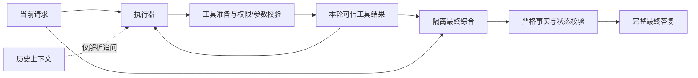

# 通用 Agent 流程与验证

更新：2026-10-09。Agent 1.2.12，算力端 1.0.16，均已安装。本记录作为当前实现说明；旧版本的单次通过记录不能证明后续版本或所有自然语言请求正确。

验收优先级：按用户确认，优先验证通用架构和控制流程；Qwen2.5-7B 的需求遗漏、工具选择和综合质量独立记录，不为某种问法添加公共控制器分支。程序检查也不能证明模型已理解所有隐含需求。原生文本乱码是已知遗留问题，按用户明确要求排除本轮；未为此次发现的乱码新增修复或猜字规则。

## 通用控制边界

公共控制器按照任务状态、工具注册契约和实际结果推进，不按城市、车次、衣服或某个样例答案分支。新工具通过输入/输出 schema、权限、公开证据字段和准备/验证接口注册。

- 模型生成完成、工具执行完成和整个任务完成分别处理。算力卡片的一次 `Final` 可能仍是执行阶段草稿，不能自动当作整个任务结束。
- 输入整批先校验再执行。权限、并行和缓存来自可信注册策略；模型不能自行授予。未知/写操作不会按只读方式并行或缓存，执行结果不确定后不自动重放。
- 工具准备接口接收不可修改的原始请求，供工具自身校验模型参数；公共控制器不解析领域语义。相对时间等业务参数由对应工具负责。
- 最终综合最多一次，只接收当前请求和本轮证据。提示和模型接口两处均不传旧答案，防止历史天气/数值污染新结果。执行阶段仍可使用历史解析引用。
- 综合阶段没有工具调度权限。重复已完成的可缓存只读请求转入一次综合，不重复执行，也不直接丢弃额外写作。
- 严格输出 schema、状态、调用标识和声明事实始终检查。明确声明为措辞启发式的检查在成功结果完成语义综合后不再整体抹掉答复。
- 停止和超时先在本地结束等待；迟到结果隔离。取消并不承诺远端操作已回滚。

## 已定位并修复的原因

1. 新规划协议默认启用，但真实模型不能稳定遵守；提示还同时要求/禁止 Plan。默认恢复普通 ReAct，高级结构化协议需要显式启用并做模型适配验证。
2. 合法 For/Execution 元数据排列被拒绝；一致重复声明与完整 JSON 后冗余闭合符已兼容，混合操作/答案与损坏参数仍拒绝。
3. 已知必需调用尚未执行就提示汇总；现在先执行缺失项。普通 ReAct 的部分证据阶段也明确允许补充缺失的独立查询，不仅是依赖操作。
4. 自然语言措辞被当成硬证明，正确答复被替换成工具结果；现在区分严格事实检查与启发式。
5. 最终综合带入历史助手答案，改写问题后今天/明天天气串项；综合提示与模型 context 都隔离。独立新任务取得工具证据后，执行阶段也移除旧对话；显式追问保留引用上下文。
6. 模型缩短了时间限定，工具又静默忽略“前”；工具准备现在可对照原请求，时间比较支持前/后/前后及半点。歧义或否定的上下文不强行覆盖。
7. 算力前台待命没有保持唤醒；窗口成功回调 `code=0` 还被误判为错误。当前在服务监听/本机任务运行且前台时持有窗口唤醒，停用/后台释放；异步操作串行避免迟到启用覆盖停止。

## 程序与构建验证

`node loop-chat/agent_core/tests/run-all.cjs`：207 项行为检查、3 组严格类型检查通过，后者覆盖 21、19、6 个实际 ETS 文件（有重叠），10/10 套件通过。提供方与模型受控，不能代替真机。日志：`.hvigor/contracts-regression-1.2.12.log`。

算力端实际 `EntryAbility`、窗口租约及既有计算页生命周期测试通过；缺失的测试编译桩已恢复。SDK ArkTS 编译、打包及独立签名完成，双端覆盖安装成功，保留会话和模型文件。Agent 自动签名配置指向不存在的个人证书，使用已有发布 profile 独立签名；算力项目无自动签名配置，也已独立签名。

Agent 构建/签名日志：`.hvigor/build-agent-contract-1.2.12.log`、`.hvigor/sign-agent-contract-1.2.12.log`；安装包 SHA256：`1615E390A2E1B3171FD413792039923CFBEF3259AD315E3F00AE921BFFC00C16`。算力端 SHA256：`C260BF1D4AAB4CC6010DC9B314BFD83993ECC7E62FA729E5F4294392B30AC9EE`。

## 控制流程验收边界

| 不变量 | 当前证据 |
| --- | --- |
| 新工具通过契约扩展，公共循环没有内置领域分支 | 任意工具改名、契约注册及公共模块检查 |
| 并行、缓存和权限由注册方决定 | 未声明/写操作串行；模型伪造权限被拒绝 |
| 全批输入通过校验后才产生操作 | 混合 Action/Final、未知工具、损坏参数拒绝测试 |
| 结果关联到实际调用，成功不能被汇总失败改写为工具失败 | 调用 ID、乱序返回、类型化状态及综合失败保留测试 |
| 已完成安全只读调用不重复执行；最终综合不能再调工具 | 缓存重复转综合、综合新 Action 拒绝及单次综合测试 |
| 取消/超时本地收敛；迟到输出不发布到下一任务 | 传输失败、迟到回包、页面代次、关闭清理测试 |
| 多 Worker 不越过依赖、隔离会话和证据 | 真实 Runner/Registry 受控集成：并行、依赖、失败、超时、取消、单次综合 |

普通 ReAct 依赖模型判断需求是否齐全。框架只能强制已由契约识别或 Plan 声明的必需调用，不能从任意自然语言证明所有需求均已声明。严格任务模式可以检查冻结目标的字段、证据和状态，但规划模型本身仍可能漏目标；当前 Qwen 未稳定遵守协议，因此默认关闭严格模式。不能把两种模式的保证混为一谈。

一次模型 `Final` 也可能是执行阶段的完整草稿。当前入口有工具证据时再进行一次隔离综合，之后终止；这是有上限的阶段切换，不是自动重试工具。最终综合违反契约或传输失败时保留已验证草稿或真实结果，并标明综合未完成；这类回退不等于工具调用失败。

## 真机验证

当前设备：ALN-AL00 Agent，HAD-W32 算力，本地 Qwen2.5-7B。测试脚本确认进入实际运行，另核对新原生请求/返回记录，不以点击成功代替推理提交。

- 算力前台服务启用时：临时设置 5 秒屏幕超时，8 秒后仍保持前台；真实窗口属性 `isKeepScreenOn=true`。
- 停用服务后：属性恢复 false，短超时恢复锁屏。算力临时超时已恢复；用户主动锁屏/离开应用仍按既有生命周期取消任务和连接。
- Agent 1.2.9 原问题已显示完整最终答复，保留查询结果和明确数量建议；随后改写测试暴露旧历史混入与时间限制丢失，不能视为最终版本通过。

- 1.2.11 改写测试未通过：模型遗漏查询条件及地点调用，天气提供方真实超时，综合仍编造了未查询的地点。框架保留成功调用和真实超时，没有把它伪装成完整成功；该记录是失败证据。
- 1.2.12 跨领域自然语言请求（文件列表、85×7、两句小诗）：原生只有一次模型返回 Final，Agent 最终展示与返回一致；Qwen 没发 Action，漏掉计算并复述历史文件列表。该记录验证最终交付没有被替换，不能记作工具流程或回答完整性通过。保留日志 `loop-chat/entry/build/arch1212-cross-native.jsonl` 和 `arch1212-cross-conversation.xml`。
- 1.2.12 取消：脚本确认实际进入运行后点击停止，Agent 显示“已停止生成”，算力本次实例创建后关闭，未发布迟到 Final。原生实例 5 没有 response；不能据此承诺任意外部副作用都已撤销。
- 1.2.12 恢复：后续 calculator `(37+15)*2` 和 unit_convert `20 C → F` 实际返回 success，值分别为 104、68。下一次模型请求含各自调用 ID 与实际 Observation；最终答复保留两项结果及额外写作，手机显示综合文本，没有替换为工具结果。旧取消请求的 300/5000 未进入新任务证据。
- 恢复任务原生记录为实例 6/7/8：三次 request、三次 response，其中只有一次 Action 回复（含两个调用），一次最终综合。工具没有重跑；手机回到空闲发送状态。综合开头乱码在原生日志中已经存在，属于本轮排除的遗留问题。证据：`loop-chat/entry/build/arch1212-native-raw.jsonl`、`arch1212-recover-conversation.xml`、`arch1212-recover-ui-layout.json`。

当前验收结论：本轮定位到的控制流程问题已修复，并通过受控回归、SDK 编译和上述真机工具/最终交付/取消恢复检查。结论限于这些边界，不能证明所有自然语言任务已完整理解，也不是多物理设备端到端验收。不同工具提供方的真实网络超时仍会产生失败结果，框架必须如实分项报告。

## 多算力边界与模型限制

已有 TaskPlanner、TaskCoordinator、ReActTaskWorker、ModelTaskAggregator 框架与受控多 Worker 测试，支持依赖、独立任务调度、取消、失败隔离和单次综合。

当前手机 v2 推理链路仍选一个算力端，实际工具仍在 Agent 手机运行。尚未接入多物理设备的完整 Worker 会话、容量协商、远端工具执行和任务结果协议，不能宣称已有多设备任务加速。后续应携带 taskId/subtaskId/attemptId/callId 和可信原请求/约束，按设备能力分配工作，综合节点仅接收所需证据。

现有 v2 推理 requestId 只标识一次模型调用，不能直接拿它充当上层完整任务 ID；多设备接入时要显式建立上层任务与模型请求的映射，并让每个 Worker 持有独立传输/工具会话。单请求 InferenceClient 不应共享给多个并发 Worker 或宣称大于 1 的容量。当前接口框架预留这些职责，但应用尚未完成该接线。

通用架构不等于模型具有完备的自然语言理解。领域工具当前仍有自由文本参数兼容；复杂否定、多对象和隐含条件可能需要更强的规划/综合模型或结构化工具参数。模型建议属于推断，程序回归也不能证明任意改写都正确。复杂引用应作为明确的引用材料传递，不能把所有历史助手答案重新当作本轮事实。
