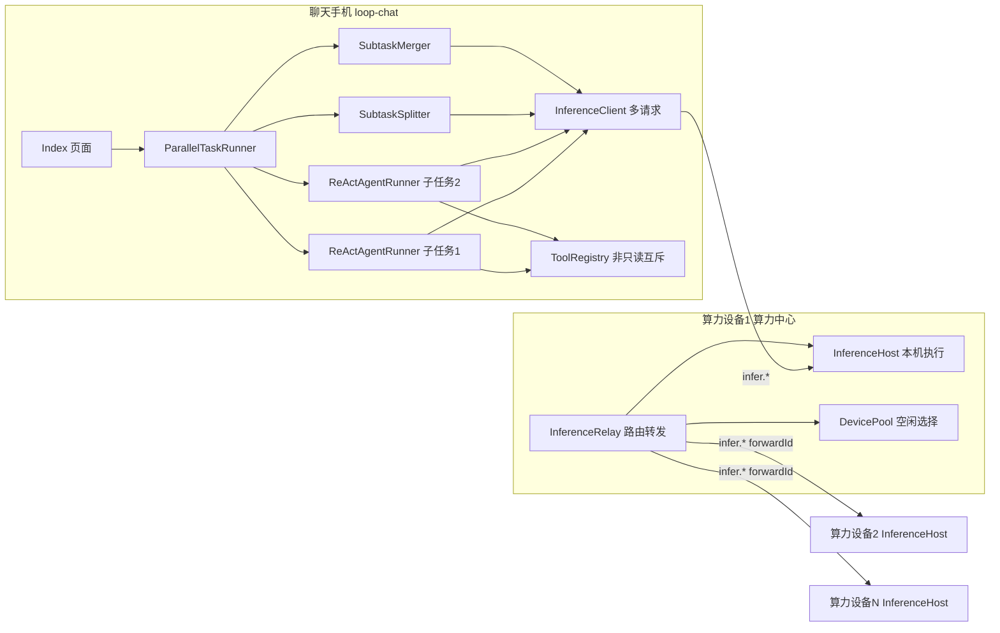
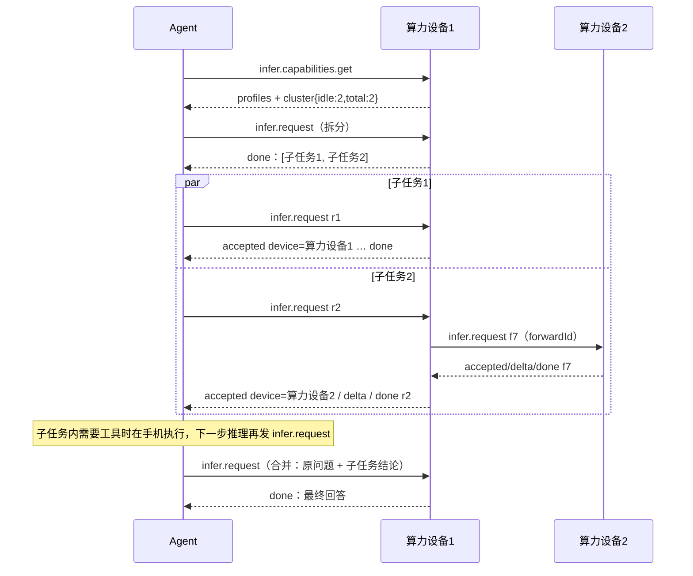

# 组合任务拆分与多算力并行：实施方案

状态：阶段 1–3 已实现并通过离线测试，未做整包编译和真机验证（阶段 4 待真机）。记录日期 2026-10-09。适用版本：loop-chat 1.2.x / compute-probe 1.0.x 之后。

## 1. 目标与范围

用户发出可拆成多个独立子任务的组合问题时：

1. 拆成 2–4 个互相独立的子任务；
2. 按算力设备是否空闲，把子任务的推理派发到不同设备并行执行；
3. 收集各子任务结果，合并成一个回答返回给用户。

不在第一版范围内：

- 子任务之间的依赖（发现依赖即退回单路）；
- 自动重放已被算力端接受的请求；
- 手机直接连接多台算力（仍只连算力设备1）。

## 2. 方案选择

讨论过两种落点：

| | A：算力中心拆分合并 | B：Agent 拆分合并，算力中心路由（采用） |
|---|---|---|
| 拆分/合并位置 | 算力设备1 | 聊天手机 Agent |
| 路由位置 | 算力设备1 | 算力设备1 |
| 支持需要工具的子任务 | 否（工具在手机，ReAct 步骤不能在算力端拆） | 是 |
| 算力端复杂度 | 编排状态机 + 拆分 + 合并 | 只做路由与转发，无任务状态 |
| Agent 端复杂度 | 很小 | 多请求并发 + 子任务调度 |

采用 B：

- **组合任务大多带工具**：天气、车次、地图这类任务都要调用工具，A 方案只能处理纯推理的子任务。
- **ReAct 协议只有 Agent 理解**：算力端拆开一个 ReAct 步骤会破坏 Action/Final 协议。
- **职责单一**：算力设备1只是一个按空闲路由的推理调度器，可以无状态地扩展到 N 台设备。

A 方案作为后续扩展保留（见第 10 节）。“按空闲路由”这一点仍由算力设备1负责，符合“算力设备1是算力中心”的定位。

## 3. 总体架构



调用关系：

- 每个子任务都是一个独立的普通 ReAct 运行，它的每一次模型调用都是一条普通的 `infer.request`。
- 算力设备1对每条请求单独选一台空闲设备执行：选到本机就本地执行，选到其他设备就转发，转发回来的结果原样回传。
- 拆分和合并也是普通的 `infer.request`，同样由算力设备1路由。

## 4. 端到端流程



## 5. 模块设计

### 5.1 算力设备1（`gate-a/compute-probe/entry/src/main/ets`）

#### `cluster/DevicePool.ets`（新增，纯逻辑，可单测）

```ts
export interface PoolNode { epoch: number; label: string; isSelf: boolean; ready: boolean; inflight: number; memAvail: number; }
export function idleNodes(nodes: PoolNode[]): PoolNode[];        // ready && inflight === 0
export function pickIdle(nodes: PoolNode[]): PoolNode | null;   // 内存大者优先，相同时优先本机
export function clusterLoad(nodes: PoolNode[]): { idle: number; total: number };
```

- **节点来源**：本机节点来自 `selfEntry()`，加上 `scheduleNodes()` 里所有已就绪、有模型的算力 peer。
- **在途计数**：`inflight` 用算力设备1自己记录的数字（复用 `ComputeRouter` 的 `inflightByEpoch` 和本机计数），不用对端上报的采样值。这样同一时刻进来的两个请求不会被派到同一台空闲设备。
- **策略可替换**：第一版只看是否空闲，后续可以换成按负载、温度打分，接口不变。

#### `llm/InferenceRelay.ets`（新增）

职责：只在算力设备1上处理来自聊天端的 `infer.request` 和 `infer.cancel`，决定在本机执行还是转发。

```ts
export class InferenceRelay {
  constructor(pool: () => PoolNode[], local: InferenceHost, sender: (m: WireMessage, epoch: number) => Promise<boolean>, events: RelayEvents);
  handleFromChat(message: WireMessage, chatEpoch: number): void;   // infer.request / infer.cancel / capabilities.get
  handleFromWorker(message: WireMessage, workerEpoch: number): void; // infer.accepted/delta/done/error
  chatDropped(epoch: number): void;    // 取消该聊天端的所有转发
  workerDropped(epoch: number): void;  // 对转发到该设备的请求回 infer.error
  load(): { idle: number; total: number };
}
interface Forward { chatEpoch: number; requestId: string; workerEpoch: number; forwardId: string; label: string; accepted: boolean; }
```

规则：

1. **收到请求时选设备**：用 `pickIdle()` 选一台空闲设备。
   - 没有空闲设备：回 `infer.error code=BUSY retryable=true`，此时一定还没有回 `accepted`。
   - 选中本机：交给本机 `InferenceHost.handle()`，并在本机计数里加 1，结束时减 1。
   - 选中其他设备：生成唯一的 `forwardId`（复用 `ComputeRouter.nextForwardId`），记下转发记录，把请求转发给该设备。转发前改写三处：`requestId` 换成 `forwardId`；`deadlineBudgetMs` 减去 5000 作为中转余量；`messages`、`maxOutputTokens` 保持不变。
2. **执行设备回复时**：只按 `forwardId` 查转发记录，查不到或回复来自其他设备的一律丢弃。查到后：
   - `accepted`：标记已接受，把 `requestId` 换回原值，再加上 `device: label` 回给聊天端；
   - `delta`：改写 `requestId` 后原样回传，`seq` 不变；
   - `done`：改写 `requestId` 后原样回传，`lastSeq`、`outputUtf8Bytes`、`outputSha256` 都不变。增量是按顺序原样转发的，所以聊天端的校验依然成立；
   - `error`：改写 `requestId` 后回传，再删除转发记录。
3. **取消**：收到 `infer.cancel` 时，查到转发记录就把 `cancel(forwardId)` 发给执行设备，否则交给本机执行。执行设备回 `infer.error CANCELLED` 后，照第 2 条回传给聊天端，聊天端的停止确认机制因此不用改。
4. **执行设备掉线（`workerDropped`）**：对挂在这台设备上的每条转发回 `infer.error code=WORKER_LOST`。还没回过 `accepted` 的标记 `retryable=true`，已经回过的标记 `false`。
5. **聊天端掉线（`chatDropped`）**：对它的所有转发向执行设备发 `cancel`，再删除记录。
6. **忙闲变化时**：向所有聊天端 peer 推送 `infer.status {idle,total}`。

#### `llm/InferenceHost.ets`（小改）

- 能力查询的回复里增加 `cluster: {idle,total}`。算力设备1上的数值由 `InferenceRelay.load()` 提供，其他设备上固定为 `{idle: 本机空闲?1:0, total:1}`。
- 不改执行逻辑。其他算力设备收到转发来的 `infer.request` 时，和收到普通请求完全一样处理：一次只执行一个，忙时返回 BUSY。

#### `pages/Index.ets`（接线）

- 收到 `infer.*` 时，先看发送方的角色：
  - 来自其他算力设备的 `accepted/delta/done/error`，交给 `relay.handleFromWorker`；
  - 本机是算力设备1、消息来自聊天端时，交给 `relay.handleFromChat`；
  - 其余情况仍交给 `inference.handle`（其他算力设备执行转发来的请求就走这条）。
- `connectionChanged` 断开时，根据掉线一方的角色调用 `relay.workerDropped(epoch)` 或 `relay.chatDropped(epoch)`，并保留现有的 `inference.peerDropped`。
- 任务卡片沿用现有的 `createJob(workerEpoch)` 和看板，转发出去的请求在卡片上显示执行设备。

### 5.2 协议（`ChatProtocol.ets`，两端同步）

| 字段 / 消息 | 方向 | 说明 |
|---|---|---|
| `InferProfile.cluster?: {idle:number,total:number}` | 算力 → Agent | 集群空闲数量，用于判断是否拆分以及并发上限 |
| `infer.status {cluster}` | 算力设备1 → Agent | 忙闲变化时推送 |
| `infer.accepted.device?: string` | 算力 → Agent | 实际执行设备的名称，供界面显示 |
| `infer.error.code` 新增 `WORKER_LOST` | 算力 → Agent | 执行设备掉线 |

全部新增字段都是可选的。旧版 Agent 忽略这些字段时不受影响，行为就是“自动按空闲路由”。

### 5.3 聊天手机 Agent（`loop-chat`）

#### `entry/src/main/ets/model/InferenceClient.ets`（同时支持多个请求）

- `pending: StreamState | null` 改为 `Map<requestId, StreamState>`。原有的 `seq` 校验、`sha256` 校验、超时、停止确认都改成按请求分别处理。
- **BUSY 处理**：如果在 `accepted` 之前收到 `BUSY` 或可重试的 `WORKER_LOST`，请求不报失败，而是进入 `waiting`。等收到 `infer.status` 显示 `idle > 0`，或者等待 1.5 s 后用新的 requestId 重发。同一请求等待的总时长计入它自己的超时。
- **`accepted` 之后的失败**：不重发，直接把错误交给上层。
- **断链**：一条链路断开时，挂在这条链路上的所有请求都失败。
- **新增接口**：`clusterLoad(): {idle,total}` 和 `setLoadListener(fn)`。`InferHooks` 增加 `onAccepted?(device: string)`。
- **停止**：`cancel()` 改为取消本 Agent 的所有请求；新增 `cancelRequest(id)`，供单个子任务的模型调用使用。

#### `entry/src/main/ets/model/RemoteComputeModel.ets`

- 每个子任务创建一个实例，`cancel()` 只取消自己发出的那条请求，不能取消整个客户端。

#### `agent_core/src/main/ets/agent/parallel/`（新增）

```ts
// SubtaskSplitter.ets
export interface Subtask { id: string; title: string; task: string; }
export function shouldTrySplit(task: string): boolean;             // 规则粗筛
export async function splitTask(task: string, history: string, model: LocalModel): Promise<Subtask[] | null>;

// SubtaskMerger.ets
export interface SubtaskOutcome { id: string; title: string; device: string; status: 'ok' | 'partial' | 'failed' | 'cancelled'; text: string; }
export async function mergeOutcomes(task: string, outcomes: SubtaskOutcome[], model: LocalModel): Promise<string>;
export function concatOutcomes(outcomes: SubtaskOutcome[]): string;   // 合并失败时的保底拼接

// ParallelTaskRunner.ets
export interface ParallelHooks { onPlan(subtasks: Subtask[]): void; onProgress(id: string, phase: string, device: string): void; }
export class ParallelTaskRunner {
  constructor(deps: { modelFor: (subtaskId: string, hooks: InferHooksLike) => LocalModel; tools: ToolRegistry; concurrency: () => number; ... });
  run(task: string, conversation: ConversationContext, hooks: ParallelHooks, listener: AgentEventListener): Promise<void>;
  requestStop(): void;
}
```

**拆分（`SubtaskSplitter`）**

- **规则粗筛**：满足以下任一条件才调用模型拆分，否则直接走单路：
  - 出现 2 个及以上问句；
  - 出现“分别 / 并且 / 同时 / 另外 / 还有 / 以及 / ；”或编号列表；
  - 全文超过 40 字，并且包含两个及以上动作词。
- **模型拆分**：调用一次模型，只输出一个 JSON 数组，不可拆就输出 `[]`：

  ```text
  把用户请求拆成互相独立、可同时进行的子任务。每个子任务必须完整自述（把“这/那/上面”等指代替换成具体内容），不得依赖其他子任务的结果。
  不可拆、只有一个任务或子任务之间有依赖时输出 []。最多 4 个。
  只输出 JSON：[{"title":"短标题","task":"完整子任务"}]
  ```

  拆分时附带最近一次对话（用户问题加回答，不超过 1500 字），用来展开指代。
- **严格校验**：以下任一情况都返回 `null`，退回单路执行：
  - 解析失败；
  - 结果不是数组；
  - 子任务数量不在 2 到 4 之间；
  - `task` 为空或超过 500 字；
  - 某个子任务与原问题完全相同；
  - 子任务里出现“上一步 / 根据子任务 / 以上结果”这类依赖词。

**调度（`ParallelTaskRunner`）**

1. **判断要不要拆**：`concurrency()` 取 `clusterLoad().idle`。只有它不小于 2 且 `shouldTrySplit` 为真时才调用拆分，否则调用现有单路流程，现有代码完全不动。
2. **拆分成功后**：调用 `onPlan`，然后启动子任务。同时运行的子任务数不超过当前 `idle`，最少 1 个。剩下的子任务排队，有子任务结束或收到 `infer.status` 时再补派。
3. **每个子任务**：用 `new ReActAgentRunner(modelFor(id), tools, MAX_STEPS, skills, ...)` 运行 `subtask.task`。
   - **不带对话历史**：拆分阶段已经展开了指代。
   - **工具调用命名空间**：用 `taskId/subtaskId`，这样停止时可以按前缀取消，复用现有的 `cancelActive(prefix)`。
   - **最终答案**：收到 FINAL 事件后，`status` 由事件决定：`partial` 计为部分完成，否则为成功。ERROR 事件计为失败。
   - **进度上报**：通过 `onProgress` 报告当前阶段（生成中、正在调用工具：xxx、整理中）和 `device`（来自 `onAccepted`）。
4. **时限**：
   - 每个子任务 240 s，超时就调用它自己的 `requestStop` 并计为失败；
   - 整轮 300 s，合并阶段单独再给 120 s。
5. **合并**：所有子任务结束后，调用 `mergeOutcomes` 做一次推理。
   - **输入**：原始问题、每个子任务的标题、状态和结论。失败的子任务明确写成“该部分未能完成：原因”，不能写成事实。
   - **合并失败或停止时**：改用 `concatOutcomes`，按子任务分段直接展示。
6. **最终结果**：
   - 全部子任务成功且合并成功时，发 FINAL；
   - 否则发 FINAL 并标记 `partial`。按已实现的规则，`partial` 只在历史里记一句说明，不当作完整答案保存。
7. **停止**：`requestStop()` 依次执行：
   - 停止所有子任务的 runner 以及正在进行的拆分或合并调用；
   - 清空排队中的子任务；
   - 取消本轮所有推理请求，`InferenceClient` 会逐个等待停止确认。

**工具并发（`ToolRegistry` 小改）**

- 多个子任务共用一个工具注册表。增加一把全局的非只读互斥锁：
  - `metadata.readOnly !== true` 的工具调用要先拿到这把锁，所以写文件这类操作会串行执行；
  - 只读且 `supportsParallel` 的工具可以并发执行。
- 工具调用的 callId 已经带了命名空间，各子任务的证据不会混在一起。

#### `entry/src/main/ets/pages/Index.ets`

- **入口**：`runRemoteAgent` 改为先判断要不要并行，并行时用 `ParallelTaskRunner`，否则走原来的 `ReActAgentRunner`。停止、页面销毁、链路变化的处理方式不变，只是把 `activeRunner` 抽象成都有 `requestStop()` 的接口。
- **界面**：
  - 拆分成功后，过程气泡里显示一张子任务卡，每个子任务一行：`① 查北京天气 · 算力设备2 · 正在调用工具：weather…`；
  - 合并阶段占位显示“正在合并 3 个子任务结果…”，合并的增量直接显示在回答气泡里；
  - 失败的子任务那一行显示红色状态和原因。

## 6. 状态与错误矩阵

| 场景 | 算力设备1行为 | Agent 行为 | 用户可见 |
|---|---|---|---|
| 无空闲设备 | 返回 BUSY，可重试，此时还没回过 accepted | 子任务的模型调用进入等待，收到空闲通知后重发 | 子任务显示“排队中” |
| 执行设备在 accepted 前掉线 | 返回 WORKER_LOST，可重试 | 同上，重发 | 无感或显示“排队中” |
| 执行设备在 accepted 后掉线 | 返回 WORKER_LOST，不可重试 | 该子任务失败，其他子任务继续 | 该行失败，最终回答标记为部分完成 |
| 算力设备1掉线 | — | 所有请求立即失败（已实现），整轮结束 | “连接已中断” |
| 用户停止 | 转发 cancel，执行设备回 CANCELLED | 停止全部子任务，等待停止确认，再允许新请求 | “已停止生成” |
| 拆分输出不合法 | — | 退回单路 | 与现在一致 |
| 子任务超时 | 收到 cancel | 该子任务失败 | 部分完成 |
| 合并失败 | — | 按子任务分段拼接 | 分段回答，标记为部分完成 |
| 收到迟到或未知的 forwardId | 丢弃 | 按 requestId 丢弃 | 无 |

## 7. 关键约束（实现时必须保持）

- **请求标识**：子任务里的每次模型调用都有唯一的 `requestId`；算力设备1转发时的 `forwardId` 只由它自己生成，查转发记录也只按 `forwardId` 查。
- **重发边界**：只有还没被接受的请求才允许重发。已经被接受的请求失败后绝不自动重发，因为工具可能已经执行过。
- **增量顺序**：执行设备的增量顺序不能被打乱，算力设备1只改写 `requestId`，不拼接、不重新编号。
- **子任务隔离**：子任务的证据和工具调用命名空间互相隔离，合并阶段不执行任何工具。
- **结果状态**：部分完成的结果不写入历史，不能当作已确认的结论。
- **单路兜底**：空闲设备少于 2 台、规则判断不可拆、拆分失败时，都必须走现有单路流程，行为和现在完全一致。

## 8. 测试计划（node 离线测试，不含整包编译）

**算力端**：在 `gate-a/compute-probe/.../llm/` 下新增 `InferenceRelay.test.cjs` 和 `DevicePool.test.cjs`，覆盖：

- 本机空闲时在本机执行，本机忙时转发到其他设备，全部忙时返回 BUSY；
- `requestId` 和 `forwardId` 的双向改写，以及 `seq`、`sha256` 原样透传；
- 迟到的 `forwardId`、执行设备不匹配时丢弃；
- 执行设备在 accepted 前后掉线时 `retryable` 的取值不同，聊天端掉线时会向执行设备转发 cancel；
- 两个请求同时到达时不会派到同一台设备（在途计数在同步阶段就加上）；
- 忙闲变化时推送 `infer.status`。

**Agent 端**：在 `loop-chat/agent_core/tests` 下新增或扩展测试：

- `subtask-splitter.test.cjs`：规则粗筛，以及拆分校验的每一条拒绝条件；
- `parallel-runner.test.cjs`：
  - 空闲不足 2 台时不拆；
  - 并发不超过空闲数量，排队补派；
  - 部分失败时最终结果标记为部分完成；
  - 合并失败时按子任务分段拼接；
  - 停止时取消全部，且不再发出新请求；
  - 子任务超时；
- `integration-lifecycle.test.cjs`：多个请求同时进行、accepted 前的 BUSY 和重发、accepted 后失败不重发、`cancelRequest` 只影响单个请求、链路断开时全部失败；
- `index-lifecycle.test.cjs`：并行分支下的停止和页面销毁，以及部分完成不写入历史；
- 工具注册表：非只读工具串行执行，只读工具可以并发。

运行入口不变：`node loop-chat/agent_core/tests/run-all.cjs`，算力端的测试用 `node <file>.test.cjs` 运行。

## 9. 实施阶段与验收

| 阶段 | 内容 | 验收（真机） |
|---|---|---|
| 1 | `DevicePool`、`InferenceRelay`、协议字段、算力端 Index 接线 | 算力设备1忙时，普通 Agent 请求自动在算力设备2执行，卡片显示执行设备；停止、执行设备掉线都返回正确的错误 |
| 2 | `InferenceClient` 多请求、BUSY 等待和重发、`infer.status` | 两个手动构造的并发请求分别在两台设备上同时生成 |
| 3 | `SubtaskSplitter`、`ParallelTaskRunner`、`SubtaskMerger`、工具注册表互斥、Index 分支和子任务卡 | 组合问题（例如“北京明天天气怎样？顺便把‘早上好’翻译成英文和日文”）拆成 2 个子任务，分别显示设备，最终合并回答 |
| 4 | 指标与调优：日志记录拆分、各子任务、合并的耗时和执行设备（沿用 EXP 字段格式） | 同一批问题对比单路和并行的总耗时，确认并行确实更快，再决定粗筛规则的松紧 |

每个阶段单独可用，阶段 1 完成后即使不做后续阶段，多台算力也能分担负载。

## 10. 扩展方向

- **路由策略**：在 `DevicePool.pickIdle` 中加入负载、内存、温度、模型版本打分，或者让一台设备有多个执行槽位（MiniPC 可以同时跑多个会话）。
- **有依赖的子任务**：拆分结果增加 `dependsOn`，`ParallelTaskRunner` 按就绪顺序派发，依赖结果作为参考上下文传入。也可以直接切到现有的 `TaskCoordinator`，它已经实现了依赖阻断和取消隔离。
- **算力中心直接合成（第 2 节的方案 A）**：对纯推理的组合请求，Agent 发 `split:'allow'`，由算力设备1内部拆分、并行、合并后一次性返回，省掉手机与算力设备1之间的多次往返。
- **会话粘滞**：如果以后 native 支持复用 KV 缓存，可以让同一子任务的多步推理固定在同一台设备上，在转发记录里加一个亲和键即可。

## 11. 设计阶段发现的问题与对策

| 问题 | 影响 | 对策 |
|---|---|---|
| Agent 的 `InferenceClient` 同一时刻只有一个请求 | 无法并发 | 改成按 requestId 管理多个请求，停止确认也按请求分别处理（第 5.3 节） |
| 手机只连算力设备1，直连其他算力会被对方断开 | 无法直接派到其他设备 | 由算力设备1转发，其他设备不用改（第 5.1 节） |
| 现在算力设备1只转发普通聊天的 `request`，`infer.request` 只在本机执行，忙时返回 BUSY | Agent 请求无法分担 | 新增 `InferenceRelay`，转发 `infer.*` 全部消息 |
| ReAct 步骤的 prompt 不能在算力端拆分 | 方案 A 只能覆盖纯推理任务 | 拆分放在 Agent 端，算力端只负责路由（第 2 节） |
| Qwen2.5‑7B 生成结构化计划 schema 不稳定（1.2.3/1.2.4 已记录） | 复杂拆分容易失败 | 拆分只输出 `title/task` 数组，严格校验，失败就退回单路，不影响现有流程 |
| 忙闲状态有延迟，两个请求可能同时选中同一台空闲设备 | 其中一个返回 BUSY | 在途计数在同步选点时立刻加上；漏掉的 BUSY 发生在 accepted 之前，可以安全重发 |
| 转发链路上的增量校验 | 中途改写内容会导致 sha 校验失败 | 只改写 `requestId`，`seq`、`sha` 原样透传 |
| 多个子任务共用工具注册表时，写操作可能冲突 | 文件写入互相覆盖 | 非只读工具加全局互斥；工具调用命名空间按子任务隔离 |
| 子任务里的“那个、上面”这类指代 | 子任务答非所问 | 拆分阶段带最近对话并要求展开指代，子任务本身不带历史 |
| 拆分和合并多出 2 次推理 | 简单问题反而变慢 | 只有空闲设备不少于 2 台且规则粗筛通过才尝试拆分；阶段 4 用实测数据调整规则 |
| 部分子任务失败时如何表达 | 误把不完整结果当作结论 | 最终结果标记为部分完成，不写入历史；合并提示要求失败部分不能写成事实 |

## 12. 实现记录（2026-10-09）

已落地的文件：

- 算力端：`cluster/DevicePool.ets`、`llm/InferenceRelay.ets`（新增）；`ComputeRouter.ets`（`DispatchEntry` 增加 `infer/accepted/answer`，新增 `dispatchesFromOrigin`）；`InferenceHost.ets`（`cluster` 能力字段、`isActive`、`setClusterProvider`）；`pages/Index.ets`（接线、任务卡、掉线处理）。
- 协议（两端各一份）：`cluster`、`device` 字段，`infer.status`、`WORKER_LOST`、`validCluster`。
- 手机端：`InferenceClient.ets` 重写为多请求（`calls`、`queued`、`waitingCalls`、按请求的停止确认、BUSY 等待重发、`cancelOwner`、`clusterLoad`）；`RemoteComputeModel` 支持 `owner`；`agent/parallel/` 下的 `SubtaskSplitter`、`SubtaskMerger`、`ParallelTaskRunner`；`ToolRegistry` 非只读工具串行；`pages/Index.ets` 并行分支与子任务进度行。
- 测试：`InferenceRelay.test.cjs`（14 项）、`parallel-runner.test.cjs`（12 项）、`integration-lifecycle`（新增 7 项）、`index-lifecycle`（新增 4 项）、`tool-contracts`（新增 1 项）。`run-all.cjs` 11/11 通过。

与方案的差异和实现中遇到的问题：

| 问题 | 处理 |
|---|---|
| 单一 `pending` 无法并发；测试直接读 `client.pending` | 改为按 requestId 的 `calls` 映射，测试同步改为检查 `calls.size` |
| 请求等待重发期间不在 `calls` 里，取消时会漏掉 | `cancelMatching` 同时遍历 `waitingCalls`；等待中的请求没有占用算力端，不发 `infer.cancel`，也就不会因等不到停止确认而阻塞后续请求 |
| `infer.status` 需要 requestId（协议校验要求） | 固定用 `cluster` 作为 requestId |
| 工具注册表被多个子任务共用，停止某个子任务时 `cancelActive()` 无前缀会取消全部 | 子任务 runner 使用 `taskId/subtaskId` 命名空间（空 goals 的 `AgentRunContext`），停止只按前缀取消；排队中的写操作同样按前缀跳过 |
| 空闲状态的计数依赖对端采样，有延迟 | 算力设备1按自己的转发账本（`workerLoad`）计数，本机用 `selfLoad` 与 `InferenceHost.isActive()` 的较大值；残留的竞争只会产生 accepted 之前的 BUSY，由手机端等待重发 |
| 工具子任务的 ReAct 步骤各自路由，一个子任务内的多次推理可能落在不同设备 | 每次请求带完整 prompt，结果正确性不受影响；界面显示最近一次接受请求的设备 |
| 子任务界面 | 没有新增气泡类型，子任务行显示在“生成中”占位气泡里，合并答案替换它 |
| 未实现 | 算力中心内部拆分（第 10 节方案 A）、有依赖的子任务、按负载打分路由 |

真机验证建议：

1. 两台算力都在线，发送“查北京明天天气，并且把‘早上好’翻译成英文”，应看到两行子任务分别显示不同设备，最终得到合并回答。
2. 其中一台算力在子任务执行中断开：对应行失败，最终回答标注“未得到完整回答”，且不写入历史。
3. 并行执行中点击停止，随后立即发送新问题，不应出现 BUSY。
4. 只有一台算力在线时，行为应与改动前一致。