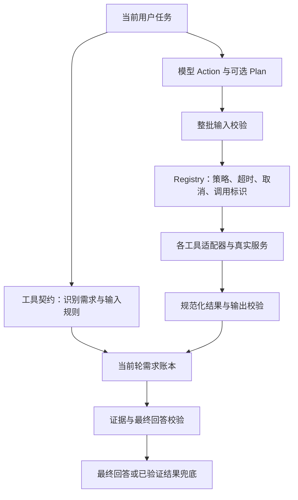

# Agent 工具契约与回归记录（1.2.0）

> 历史记录：后续重复真机测试仍出现综合漏答和事实不一致，因此下述单次通过不能证明持续稳定。此后已移除衣服数量等专用结束规则，改用通用交付项与必答字段。1.2.1 的严格协议又暴露真实模型格式兼容问题；当前实现和验证边界见 [通用任务流程与多算力边界](agent-multi-compute-architecture.md)。

更新日期：2026-10-08。目标是让工具执行、结果关联和结束判定成为可扩展的公共机制，避免为具体提问在 Runner 中增加条件分支。

## 分层与职责

- `ReActCore.ets`：解析 Action/Plan，建立需求账本，按调用标识和输入绑定结果，调度契约校验。没有天气、高铁、地图或计算工具名分支。
- `ReActAgentRunner.ets`：执行循环、上下文与预算、整批校验、缓存和安全并行、终止控制。通过工具声明选择行为。
- `ToolContract.ets`：通用输入/输出 schema 校验、规范化输入键、公共证据字段、结果归属和最终回答检查。
- `ToolRegistry.ets`：工具注册与策略边界、结果规范化、超时/取消、生命周期。内置工具的创建留在组合入口，执行策略不由工具名决定。
- `agent/contracts/`：天气、路线、地点、文件、发现服务、计算/换算等适配器自己的语义规则。领域规则仍然存在，但由各自工具负责，不能改写公共执行状态或其他工具的调用。

## 新工具如何接入

工具实现 `AgentTool`，提供 `name()`、`description()`、`run()`，并通过 `contract()` 或 `registry.register(tool, policy, contract)` 声明契约。注册一个新工具不需要修改 Core 或 Runner。

核心声明包括：

| 声明 | 作用 |
| --- | --- |
| `version`、`inputFormat` | 契约版本；JSON、原始文本、无参数输入 |
| `inputSchema`、`outputSchema` | 执行前校验参数，成功返回后校验结果 |
| `evidenceFields` | 允许送给模型并用于结束检查的公共事实字段 |
| `answerScopeFields` | 按对象标识筛选回答片段，避免同工具多个对象的事实交换 |
| `answerLabels`、`tolerance` | 按数值标签检查对应结果，允许工具声明数值容差 |
| `recognize`、`matches`、`prepareInput` | 可选的领域需求识别、调用匹配和参数修正 |
| `validateAnswer` | 可选的领域回答校验 |
| `legacyStatus`、`legacyData` | 旧字符串工具的状态和数据转换 |
| `finalization` | 声明结果能否直接展示，或需要模型综合 |
| 注册策略 | 只读、并行、缓存、风险和超时；由可信注册入口授予 |

例如，新库存查询工具可声明 JSON 输入 `sku`，返回结构化 `data: {sku, quantity}`，使用 `answerScopeFields: ['sku']` 和必需的数量证据字段。这样 `SKU4 quantity: 0`、`SKU40 quantity: 20` 可分别归属；交换两个数量、用列表编号 0 冒充数量、把 SKU40 当作 SKU4 都会被拒绝。此场景使用独立测试工具验证，无需添加库存工具名分支，也没有接入真实库存服务。

ArkTS 的 schema 属性映射可使用导出的 `schemaProperties(names, definitions)`，并将嵌套定义显式标为 `ValueSchema`，避免 ArkTS 对非空 Record 字面量的限制。

## 执行和结果规则

1. 一批 Action 必须全部通过格式和输入契约校验，之后才能执行第一项。无效的同批参数不能让此前的写操作先发生。
2. 模型可在 Action 前提供 `Plan: {"requirements":[{"id":"r1","tool":"实际注册名","input":{},"label":"所需结果"}]}`。计划只能声明需求，不能声明成功状态、伪造权限或重分配已使用的需求 ID。
3. 模型输出和工具返回都不能接管可信 `callId` 或注册策略。内部 `invocationId` 另行递增，避免旧调用的迟到回调污染后来复用的公开调用 ID。
4. 成功、失败、空结果、不可用分别保留。成功的结构化返回若违反输出 schema 或缺少必需事实，会变成明确失败。失败结果不能被模型文字“说成成功”。
5. 注册时只读且低风险的工具才可能启用并行或缓存；无策略的工具按高风险处理。缓存键按契约规范化 JSON 属性顺序，每次调用仍有自己的结果标识。
6. 默认工具超时 60 秒，可声明 1–300000 毫秒。超时或停止先在本地结束等待，再尝试调用工具取消接口；取消异常不会阻塞 Runner。迟到结果不进入当前轮最终回答。写工具抛出提供方异常时也停止自动推进，避免提交结果不确定后被自动重复执行。
7. 写操作超时代表结果不确定，停止自动推进；取消不是远端回滚保证。Registry 关闭会结束等待，清理失败不阻止其他清理，关闭后不允许重新注册/执行。
8. 模型只能收到声明的公共证据字段。额外的 `data` 字段不自动进入提示词；工具展示文字本身仍应由适配器负责避免泄露私有内容。
9. 对声明 `finalization: 'result'` 的工具，模型给出通过校验的 Final 后，若工具自身的展示结果也满足证据约束，使用工具展示结果。这样多项计算结果不会被模型拼成带重复键的 JSON；仍等待 Final 边界，避免提前截断多阶段任务。展示缺少事实时保留经过验证的模型回答。

## 兼容范围与边界

- 旧 `run(input): Promise<string>` 工具继续可用。旧工具应声明自己的错误前缀与数据转换；公共层不再按某些工具名猜测状态。
- Schema 是明确受支持的 JSON Schema 子集：类型、properties/required、布尔 additionalProperties、items、enum、数值/长度/项数边界、anyOf，以及说明性字段。不是完整 JSON Schema 实现；未知校验关键字在注册时拒绝。深度和校验值数量有上限。
- 任意新领域的自然语言并不会自动获得完备语义理解。可通过工具的识别/匹配钩子、用户明确点名调用、或模型 Plan 建立需求。Plan 能校验已声明需求，但不能证明模型没有遗漏原始任务中的隐含需求。
- 通用事实检查是保守的文本检查，不是任意自然语言的形式化证明。复杂的多对象或解释性回答可提供领域 `validateAnswer`；按范围检查会拒绝含混的共同片段。
- Plan 当前表达具体的所需调用，不包含 DAG、引用上一步输出或事务执行。
- 本次保持现有近场协议兼容，算力端仍为 1.0.14。

## 已完成验证

运行入口：`node loop-chat/agent_core/tests/run-all.cjs`，不安装依赖、不调用真实外部写接口。

| 回归组 | 结果 |
| --- | --- |
| Runner/领域行为 | 73/73 |
| 支持模型与工具 | 21/21 |
| 集成契约 | 11/11 |
| 集成生命周期 | 16/16 |
| Index 生命周期 | 9/9 |
| 推理预算 | 7/7 |
| 新增实际 Registry/Runner 契约测试 | 26/26 |
| 合计 | 163/163 |

另有 3 组严格 noEmit 类型检查通过，分别覆盖 15、19、6 个实际 ETS 文件（有重叠）；支持模型检查有 2 条既有 SDK 警告，无错误。离线测试的系统平台和提供方受控，不能替代真机或完整 ArkTS 编译。

新增测试涵盖新工具改名/带点名称、不修改 Core/Runner 的注册扩展、结构化 Plan、多需求覆盖、同批校验、输出错误、状态伪造、规范化缓存、文本/无参数输入、事实串项与标签/容差、回调越权、超时、取消、迟到回调、重复关闭及写工具策略。多个城市的穿衣数量需求与多个路线/时间的空时间窗替代说明也有回归；这些规则属于对应工具适配器。

完整 SDK 构建日志：`loop-chat/.hvigor/build-agent-contract-1.2.0-final.log`。`CompileArkTS`、`PackageHap`、`PackingCheck` 完成；自动 `SignHap` 因项目指向的个人证书路径不存在而失败。随后使用现有发布 profile 独立签名成功，日志为 `sign-agent-contract-1.2.0.log`。安装返回 `install bundle successfully`，设备版本确认为 1.2.0，保留已有会话。

最终签名包 SHA256：`1D2236B2388817A5BFD56BEF9B3CD737E200750CE1B2E78922882893AA769FCE`。

## 真机回归

设备：Agent ALN-AL00（1.2.0），算力 HAD-W32（1.0.14），本地 Qwen2.5-7B。保留用户会话，不清除应用数据。

- 原组合问题取得真实高铁、天气、地图结果。初次汇总把最近替代车次称为时间窗内车次，并漏答衣服数量；补齐工具适配器校验后，1.2.0 回答明确时间窗内无车次、北京明天天气阴 14.3–25.8°C、建议穿 2 件，以及丽泽 SOHO 的地图匹配地址。它没有再将成功工具说成失败。
- 新数值组合 `(21+7)*4` 和 `2.5 km → m` 返回 112、2500，实际 Action 和 Observation 的调用标识独立，执行记录可展开。
- 最终签名包停止测试：15:25:29 手机发出 `infer.cancel`；15:25:31 算力端收到取消并返回 `CANCELLED`。手机显示“已停止生成”。后续请求成功，旧请求未产生迟到答案。
- 最终签名包恢复测试：`(37+15)*2` 与 `20°C → °F` 返回 104 和 68。最终分别显示 `calculator：计算结果：104` 与 `unit_convert：20 c = 68 f`，不再显示模型生成的重复 JSON 键，也没有混入被取消任务的 180/8000。
- 最终签名包文件列表测试：实际执行 `list_sandbox_files({"relativePath":""})`，列出 4 个已有文件；最终列表与真实返回一致，未写入或修改这些文件。

原始证据保存在忽略的构建目录 `loop-chat/entry/build/`，包括 `contract-final-original-conversation.xml`、`contract-final-recovery-conversation.xml`、`contract-final-files-conversation.xml`、对应页面布局、`contract-final-files-trace-layout.json`、`contract-final-cancelled-layout.json`。本地完整回归日志为 `.hvigor/contracts-regression-1.2.0.log`。

设备熄屏/应用离开前台曾中断近场连接，恢复前台并重新连接后才继续回归。这属于真实连接中断，不能当作工具或综合回答成功；本轮没有证明后台/锁屏状态的持续可用性。测试期间临时延长的熄屏等待会在结束时恢复。上一版的证据参见 [先前回归记录](agent-result-regression-2026-09-30.md)。
