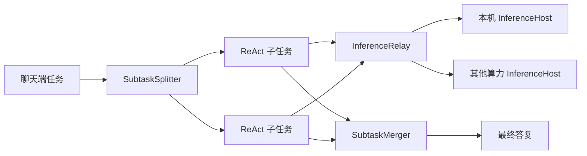

# 多算力协作

## 设备职责

聊天端连接编号为 1 的算力中心。算力设备通过 BLE 广播发现和编号，中心接收请求、选择执行节点并回传结果；执行节点处理中心转发的推理请求。工具在聊天端执行，不随模型请求移到远端。

当前 Agent 消息由 `InferenceRelay` 调度；基础双端的聊天 request 使用 `ComputeRouter`。二者共用近场基础设施，但不是相同的消息处理路径。

## 独立子任务

页面的 `ParallelTaskRunner` 在集群公告至少有两台空闲设备、请求符合组合任务粗筛时尝试一次拆分。解析结果必须是 2–4 个自述完整、互不依赖的子任务；无效、重复或依赖其他子任务的结果退回普通执行。

每个子任务拥有独立模型 owner 和工具调用命名空间。执行通道数受子任务数量及集群 total 限制；实际空闲设备由中心分配，不能把通道数当成设备已接受的数量。共享工具注册表串行化可能产生副作用的操作。

子任务终态为 ok、partial、failed、cancelled。结束后最多进行一次汇总；汇总不可用时分项展示结果，整体标为 partial。停止任务会停止活动子任务和协调模型，不发布迟到答复。

| 阶段 | 当前超时常量 |
| --- | --- |
| 拆分 | 60 秒 |
| 每个子任务 | 240 秒 |
| 子任务执行窗口 | 300 秒 |
| 汇总 | 120 秒 |

这些是阶段上限，不能将 300 秒解释为包含后续汇总的整轮绝对上限。常量位于 [ParallelTaskRunner](../apps/agent-client/agent-core/src/main/ets/agent/parallel/ParallelTaskRunner.ets)。

## 推理转发

`DevicePool` 选择就绪、有模型且空闲的节点。中心记录在途占用，避免仅依赖滞后的设备采样值。转发使用独立 forwardId，并按来源 epoch 和 ID 将响应映射回聊天端。

没有空闲节点时，在 accepted 前返回 BUSY。客户端只重发尚未被接受、允许重试的请求，并使用新 requestId；已经接受后的断链或失败不自动重放。worker 掉线只影响该节点的在途请求，聊天端掉线会取消它的转发请求。

每台 `InferenceHost` 一次接受一个当前请求；客户端可以持有多个独立请求。多请求传输不等于一台设备保证多个 Native 会话同时运行。

## 编号和接管

设备身份使用安装 UID/广播指纹，显示名称不是永久身份。当前中心按组网规则分配编号；聊天端只连接中心。中心缺席判断包含等待时间与多次扫描确认，不在短暂断链时立即换号。成员变化按连接会话同步，旧连接回调和旧清单不会复活已结束会话。

选举/接管逻辑见 [LinkEnhanceChannel](../apps/compute-node/entry/src/main/ets/nearby/LinkEnhanceChannel.ets)，路由见 [InferenceRelay](../apps/compute-node/entry/src/main/ets/llm/InferenceRelay.ets)。

任务图接口 `TaskCoordinator` 是另一组库接口，并非当前页面的独立子任务执行器。GEWU 的模型会话协作也不同于这里的独立请求路由，见 [本地模型接口](local-model.md)。
