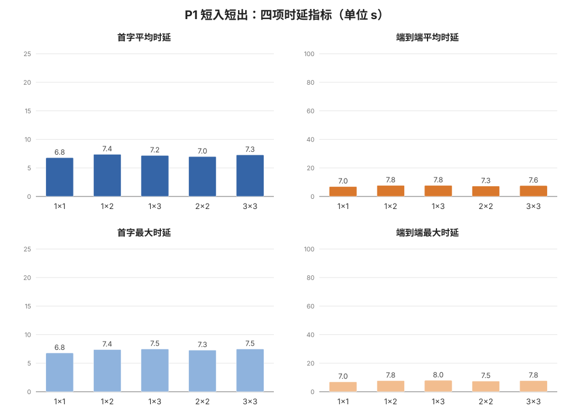
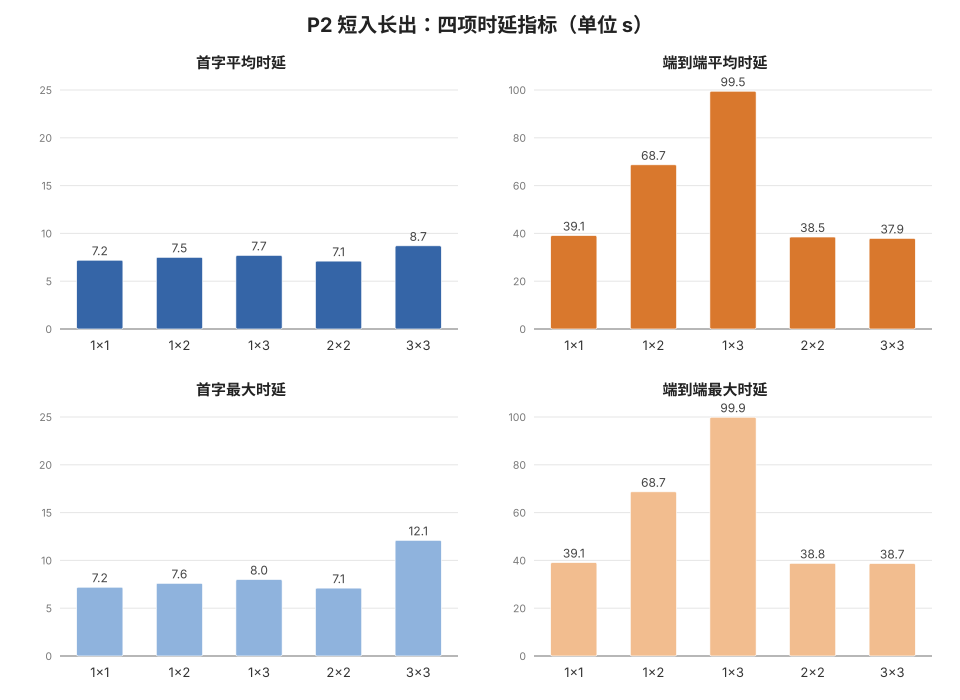
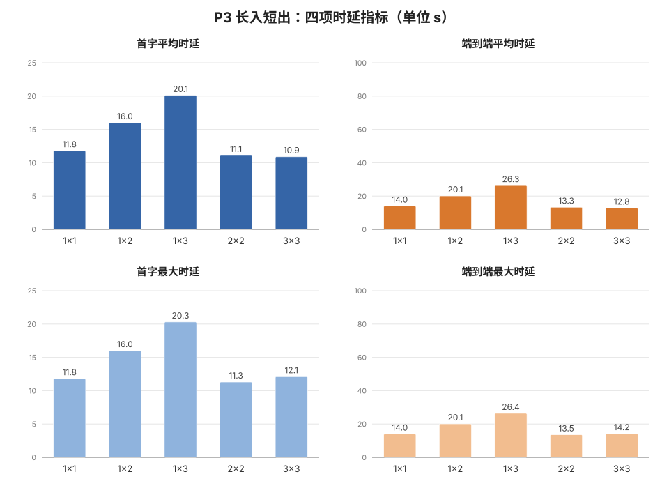
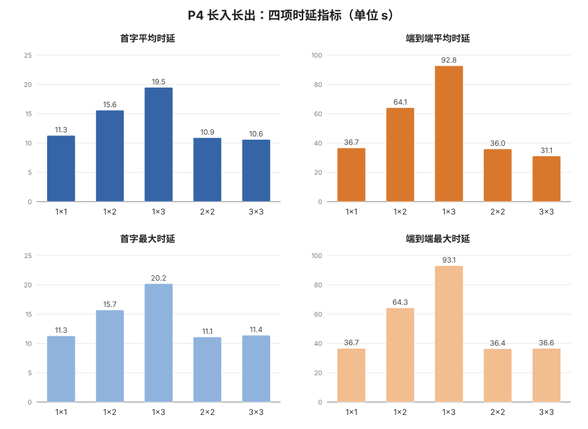

# 近场推理性能测试

测试环境：3台算力设备（SGT-AL00 + 部署Qwen2.5-7B-Instruct-Q4_N_0）× 3台聊天设备。
脚本执行机：MacBook Pro
测试日期：＿＿＿＿　记录人：＿＿＿＿

---

## 1. 指标定义与数据来源

| 指标 | 定义 | 来源（hub 仪表盘任务卡） |
|---|---|---|
| TTFT 首字时延 | 发送 → 第一个字到达 | 任务卡「首字」 |
| 总耗时 E2E | 发送 → done | 任务卡「耗时」 |
| 生成吞吐 TPS | `字数 ÷ (总耗时 − 首字)` | 任务卡「N 字」推算 |

说明：
- 所有时间一律以 **hub 仪表盘卡片时钟**为准（单一时钟源，避免手机间时钟差）。
- TPS 按字数近似 token 数（Qwen 中文约 1 字 ≈ 1 token，属近似值）。
- 「由算力设备N推理」标注每路请求的实际执行机，用于核对调度分摊。

## 2. 被测系统硬约束（直接决定 Prompt 设计）

| 约束 | 值 | 对测试的影响 |
|---|---|---|
| 单请求输出上限 `max_tokens` | 256 token | 四类用例输出均 ≤200 字定长，正常完整收尾（4.2/4.4 早期数据为截断式旧用例所测）；放宽输出需改两端 LocalChat.ets 的 max_tokens |
| 聊天输入框 `maxlength` | 1000 字符 | P3/P4 长文档 + 问题合计必须 ≤1000 字符，粘贴超长会被输入框挡掉 |
| 请求总长（含历史） | ≤1800 字符、≤7 条消息 | 历史会累积（最多 3 轮问答），**每轮之间重启聊天端 App** 保证输入纯净 |
| 单聊天机在途请求 | 1 路（activeId 单飞） | 并发度 = 聊天机台数；更多并发靠多轮 |
| 调度方式 | hub 按空闲路数/内存选**一台**执行机（pickNode） | 单请求不做拆分；并发分摊靠多请求自动散开（本轮测试的观测点之一） |
| 失败语义 | GEWU CreateSession 失败 →「模型繁忙」 | 记为**失败**，不是变慢 |
| hub 接管 | 原 1 号停用后 2 号 ≥15 秒三次扫描确认才接管 | 测试中 hub 意外掉线 → 该组合**全部作废重测** |

> 原始需求中的「2000–5000 字长输入」超出当前入口上限（1000/1100/1800 三处限制），本方案先用可执行的 ≤950 字文档压到边界；放宽限制属于代码改动，列入 §8 后续项。

## 3. 四类基准 Prompt

| 编号 | 类型 | 目的 | 实际发送内容 | 输入字符 | 预期输出 |
|---|---|---|---|---|---|
| P1 | 短入短出 | 极简延迟/高并发响应极限 | `请用一个词形容"夏天"。不要解释，不要说多余的话。` | ~26 | 个位数字；指标看 TTFT，TPS 无意义可留空 |
| P2 | 短入长出 | 流式生成与解码吞吐 | `请写一篇不超过 200 字的科幻微小说，主题是"人工智能未来十年发展"。` | 36 | ~150–230 字完整收尾（低于 max_tokens=256 上限，正常不截断）；TPS 看稳定解码段 |
| P3 | 长入短出 | 长上下文预填充（KV Cache）时延 | 附录 A 文档全文 + `根据上述文章，请用不超过 30 个字总结核心观点。` | 904 | ≤30 字；指标看 TTFT（预填充主导） |
| P4 | 长入长出 | 全链路极限（预填充+持续解码峰值） | 附录 A 文档全文 + `请详细分析上述材料中的架构漏洞，并为其编写一份包含系统拓扑、代码重构方案和迁移步骤的详细优化报告。注意报告不能超过200字。` | 941 | ~150–230 字完整收尾（不触发截断）；同时压预填充与解码 |

P3/P4 操作：把附录 A 全文粘贴进输入框，**不发送**；再补上问题后一次性发送（合计 ≤1000 字符）。粘贴后检查输入框未触发长度截断。（用 perf-test.sh 自动执行时无需手工粘贴，见 §5。）

## 4. 测试结果

各节柱状图由 `node scripts/perf/gen-chart.mjs` 从本节表格生成（数据更新后重跑即可同步）。

### 4.1 短入短出
| 算力设备数 | 聊天并发数 | 首字平均时延 | 端到端平均时延 | 首字最大时延 | 端到端最大时延 |
|---|---|---|---|---|---|
|1|1|6.8|7.0|6.8|7.0|
|1|2|7.4|7.8|7.4|7.8|
|1|3|7.2|7.8|7.5|8.0|
|2|2|7.0|7.3|7.3|7.5|
|3|3|7.3|7.6|7.5|7.8|



*y 轴刻度四张用例图全局统一（首字 0–25s / 端到端 0–100s），柱高可跨用例直接对比；柱顶标数值，横轴＝算力数×聊天并发数。*

> 小结：TTFT 恒定 ~7s，E2E 仅高出 0.2–0.8s（个位字输出）；并发 1→3、算力 1→3 几乎不影响指标（E2E 最大 8.0s）。~7s 即链路传输+建会话+短预填充的固定开销底座，并发不放大。

### 4.2 短入长出
| 算力设备数 | 聊天并发数 | 首字平均时延 | 端到端平均时延 | 首字最大时延 | 端到端最大时延 |
|---|---|---|---|---|---|
|1|1|7.2|39.1|7.2|39.1|
|1|2|7.5|68.7|7.6|68.7|
|1|3|7.7|99.5|8.0|99.9|
|2|2|7.1|38.5|7.1|38.8|
|3|3|8.7|37.9|12.1|38.7|



*y 轴刻度四张用例图全局统一（首字 0–25s / 端到端 0–100s），柱高可跨用例直接对比；柱顶标数值，横轴＝算力数×聊天并发数。*

> 小结：TTFT 稳定在 7–8s（3|3 个别轮 12.1s），瓶颈在解码。单算力下 E2E 随并发线性叠加（39→69→100s，每多一路 +~30s，折算解码 ≈6–7 字/s）；2|2、3|3 摊载后回到 ~38s ≈ 1|1 水平，横向扩展接近线性。

### 4.3 长入短出
| 算力设备数 | 聊天并发数 | 首字平均时延 | 端到端平均时延 | 首字最大时延 | 端到端最大时延 |
|---|---|---|---|---|---|
|1|1|11.8|14.0|11.8|14.0|
|1|2|16.0|20.1|16.0|20.1|
|1|3|20.1|26.3|20.3|26.4|
|2|2|11.1|13.3|11.3|13.5|
|3|3|10.9|12.8|12.1|14.2|



*y 轴刻度四张用例图全局统一（首字 0–25s / 端到端 0–100s），柱高可跨用例直接对比；柱顶标数值，横轴＝算力数×聊天并发数。*

> 小结：904 字预填充使 TTFT 较 P1 抬升 ~5s（7→11.8s），E2E 仅再高出 2–6s。单算力下预填充串行，TTFT 每排队一路 +~4s（11.8→16.0→20.1）；2|2、3|3 回到 ~11s 基线。TTFT 由预填充主导。

### 4.4 长入长出
| 算力设备数 | 聊天并发数 | 首字平均时延 | 端到端平均时延 | 首字最大时延 | 端到端最大时延 |
|---|---|---|---|---|---|
|1|1|11.3|36.7|11.3|36.7|
|1|2|15.6|64.1|15.7|64.3|
|1|3|19.5|92.8|20.2|93.1|
|2|2|10.9|36|11.1|36.4|
|3|3|10.6|31.1|11.4|36.6|



*y 轴刻度四张用例图全局统一（首字 0–25s / 端到端 0–100s），柱高可跨用例直接对比；柱顶标数值，横轴＝算力数×聊天并发数。*

> 小结：TTFT 与 P3 同型（11.3/15.6/19.5 → 多算力 ~11s）、E2E 与 P2 同型（37→64→93s → 多算力 ~31–37s）——长入的预填充成本与长出的解码成本独立叠加，符合控制变量预期。3|3 两轮 E2E 31.1/36.6s，轮间抖动 ~5s。

**四类横比**：固定开销 ~7s（P1）；~900 字预填充 +4–5s TTFT（P3/P4）；解码 ≈6–8 字/s（200 字 ≈ 25–32s，P2/P4）。单算力时并发请求完全串行（E2E ≈ TTFT + n×~30s）；2/3 台算力经 pickNode 摊载后，各用例 2|2、3|3 均回到 ≈1|1 水平，横向扩展接近线性。

## 5. 测试执行：perf-test.sh

`scripts/perf/perf-test.sh`（在仓库根目录执行）负责把 §3 的基准 Prompt 注入选定聊天设备的输入框，并让多台设备**同一时刻**点击发送（聊天并发数 = 设备台数）。四类 Prompt 全文内置于脚本（`case_prompt`），与 §3 定义对应。计时与记录不依赖脚本，一律以 hub 仪表盘为准（§1）。

### 前提（每轮执行前人工确认）

1. 设备解锁亮屏，chat-end 在前台**聊天页**且「协同已就绪」；
2. 上一轮生成已结束（发送键显示「发送」而非「停止生成」）；
3. 按 §2 要求，每轮之间重启聊天端 App 清空历史（脚本不做）；
4. 本机可用 `devecocli`、`python3`，`hdc` 在 PATH 或 DevEco Studio 默认路径（自动探测）。

### 用法

```bash
./scripts/perf/perf-test.sh -h
./scripts/perf/perf-test.sh -p P1 -n 3
./scripts/perf/perf-test.sh -p P3 --devices 192.168.43.113:44231,192.168.43.114:37495
```

| 参数 | 说明 |
|---|---|
| `-p <P1..P4>` | 必填，选择 §3 基准 Prompt |
| `-n <1\|2\|3>` | 同时执行的设备台数（默认 3, 不足时取已连接台数;按 serial 排序取前 N 台 |
| `--devices <s1,s2,…>` | 显式指定设备 serial（覆盖 `-n`；重复 serial 自动去重并告警） |
| `-h` | 查看帮助 |

### 执行流程

1. **并行注入**：向各设备输入框按坐标写入全文（设备端 `uitest inputText`）。替换式注入，自动清掉上轮残留；支持空格标点；无需先点输入框。
2. **3 秒倒计时对齐**后各设备同时点击发送（实测多台点击时刻差 < 0.5 s）。
3. 任一台注入失败 → 本轮终止（避免并发不完整）；发送阶段有失败 → 提示从 hub 核对后重跑。

### 注意

- Prompt 按单行注入：换行在注入前剥离（段落均以句号结尾，拼接不影响语义；去换行后 P3=904 / P4=941 字符，均在 maxlength=1000 内）。
- Prompt 文本不能含**单引号**（无法经设备 shell 传递），脚本会直接拒绝。
- 脚本会打印各设备的注入/发送时刻戳可供核对，但正式指标以 hub 仪表盘任务卡为准。

---

## 附录 A：长输入样例文档（P3/P4 粘贴用，全文 ≤950 字符）

```text
近场协同计算：把大模型装进口袋集群

过去十年，深度学习的算力需求增长了数十万倍，训练与推理几乎完全依赖数据中心。与此同时，手机SoC的神经网络算力也在快速增长，旗舰芯片的NPU峰值算力已达到每秒数十万亿次操作。矛盾在于：单一终端仍装不下七十亿参数的大模型，而云端推理又受制于网络时延、带宽费用与隐私合规。近场协同计算试图在两者之间开辟第三条路——把若干台可信终端组成一个临时的推理集群，让模型请求在设备之间流转，数据不出局域网。

近场组网的关键是发现与链路建立。典型方案利用蓝牙低功耗广播携带自定义厂商字段，待测设备扫描到特定标识后发起连接，再通过链路增强通道传输应用数据。整个过程中不出现IP地址与端口号，设备身份由安装时生成的唯一标识与系统可信列表双重校验，未经组网授权的陌生设备会在握手阶段被拒绝。消息按约四百八十字节切片并以Base64封装，单帧不超过一千字节，配合确认与超时机制保证弱连接下的可靠性。

推理侧通常采用量化模型降低内存占用。以七十亿参数模型为例，四比特量化后权重大约占四吉字节，加上键值缓存与运行时开销，整机需要八吉字节以上可用内存才能流畅运行。会话创建、请求提交、流式回调与销毁构成一次完整的推理生命周期，框架通过代数标记过滤迟到的回调，避免旧请求的输出污染新会话。受限于端侧内存带宽，解码速度一般在每秒十到三十个汉字之间，首字时延则取决于提示词长度与预填充效率。

调度是集群化的核心难题。协调节点需要综合各成员的空闲路数、可用内存与温度状态选择执行机，过载时宁可排队也不应盲目分发。手机散热能力有限，持续推理会触发热降频，性能在数分钟后明显下滑；电量、后台任务与蓝牙干扰同样会放大延迟抖动。工程实践倾向于保守策略：拓扑变化期间暂停后台同步，推理期间冻结组网扫描，把有限的无线电与内存带宽留给生成任务本身。

可靠性与降级同样不可忽视。链路抖动时消息分片必须在超时窗口内重组完毕，否则断链重连；执行机中途离线时，协调节点应把失败原因回传提问方，而不是让其无限等待。渐进式的失败处理——返回部分结果并明确标注缺失——通常优于全有或全无的粗暴策略。
```
